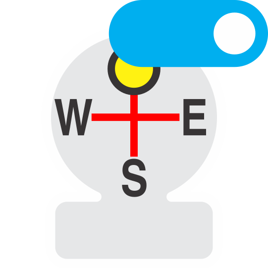

# igz_sunpath — "Sun Path" toolbar for IngeTrazo

**English** · [Português (Brasil)](README_ptBR.md)

A toolbar and side panel for [IngeTrazo](https://github.com/ingelibre/ingetrazo)
that provides a full **solar analysis** workbench: shadow toggle, date and
time sliders, calendar, a 3D **sun vector** with on-screen compass, a
dynamic **solar dome** (domus solar) with sun-path arcs and analemmas,
project-location controls integrated with IngeTrazo's **Terreno**
(Base Map) panel, **animation** of the sun along its path, and **PNG
sequence / MP4 video export** of the animated viewport.

- **Author:** Ezequiel M. Rezende
- **Repository:** <https://github.com/em-rezende/Ingetrazo-igz-sunpath>
- **Date:** 2026-11-16
- **Version:** 1.1.0
- **Tested with:** IngeTrazo 0.5.8 (Windows)
- **License:** [GPL-3.0-or-later](https://www.gnu.org/licenses/gpl-3.0.html)
  (same as IngeTrazo — see [LICENSE](LICENSE))

---


*The **Sun Path** toolbar on the top area — shadows toggle, sun-arrow
toggle, sun-vector toggle, dome toggle, **Set Sun**, **Calendar**,
**Export Sequence / Video** and **Sun Panel**. On the screen: the 3D
**solar dome** (sun-path arcs, red arc for the current day, analemmas,
compass), the **sun vector** (orange) with its projection (grey dashed)
and the **Az / El** labels near the origin, the **on-screen compass** on
the right with its Date / Time sliders, the **Set Sun** dialog on the
left and the **side panel** on the right.*

---

## Tools overview

| Tool | Toolbar button | Icon | Description |
| --- | --- | --- | --- |
| **Set Sun** | Set Sun |  | Opens the **Set Sun** dialog: date/time sliders, azimuth/elevation readout, north rotation, location box (source / coords / Set Location / Load map) and dome controls (diagram size, Set Center, analemmas/hours/dates/compass toggles) plus the four toggle buttons (Shadows on/off, Sun Arrow, Sun Vector, Sun Dome) and the **animation** controls (Play / Stop, step per frame). |
| **Calendar** | Calendar |  | Opens a compact **calendar dialog** with a date picker and a `HH:mm` time editor. Both values are applied to `scene.shadows` immediately when you click **OK**. |
| **Shadows on/off** | Shadows on/off |  | Toggles IngeTrazo's native shadows on or off. Stays synchronised with the dialog button and the side panel. |
| **Sun Arrow** | Sun Arrow |  | Shows/hides the **on-screen compass overlay** (top-right corner): rose with N/E/S/W, yellow dot at the sun's azimuth, info panel (date, time, lat, lon, azimuth, elevation) and the two **Date** / **Time** sliders. The whole overlay is draggable. |
| **Sun Vector** | Sun Vector |  | Shows/hides the **3D sun vector**: an orange ray from the dome's origin to the sun's current position, with a ball at the tip, a grey dashed projection to the XY plane and a small dot at the origin. Also shows `Az` / `El` labels next to the origin and a `HH:MM` label next to the ball. Automatically **rotated by the North offset**. |
| **Sun Dome** | Sun Dome |  | Shows/hides the **solar dome** (domus solar): monthly sun-path arcs, the **current-day arc in red**, hour marks, sunrise/sunset date labels, analemmas and the ground compass. Cells between meridians are **clickable** — clicking sets date and time simultaneously, and switches on the **Sun Vector** (turns off **Sun Arrow**). Use **TAB** to switch the semester filter (Jan–Jun / Jul–Dec). |
| **Set Center** | Set Center |  | Enters **picking mode** to choose the dome's 3D origin by clicking anywhere in the viewport. The pick uses the host's **OSNAP engine** (vertices, edges, faces) — the `uses_snap` flag on the active tool is **temporarily patched to `True`** so the `SelectTool` resolves snap; it is restored when the pick finishes. A colored preview ball shows the snap type: yellow (vertex), cyan (edge), green (face), grey (plane). Cancel with **ESC** or **right-click**. |
| **Play** | Play |  *(fallback ▶️)* | Starts the **sun animation** — advances the current time in steps (60, 30, 15, 10, 5 or 1 min per frame, configurable in the dialog or side panel) until sunset. The overlay, the vector and the dome update live. |
| **Stop** | Stop |  *(fallback ⏹️)* | Stops the running animation. |
| **Export Sequence / Video** | Export Sequence / Video |  | Opens the **ExportDialog**: choose output format (PNG image sequence or MP4 video), size (W × H), keep-aspect-ratio, include-dome, step-per-frame, then a file/folder picker. The animation runs and saves the frames (PNG) or renders the MP4. |
| **Sun Panel** | Sun Panel |  *(fallback sunpath_center.svg)* | Shows/hides the **side panel** (dock) — a compact, always-visible version of the Set Sun controls: date/time sliders, north rotation, location box, dome controls, animation controls, export settings and FFmpeg status. The panel's components are **width-dynamic** — they follow the dock when the user resizes it. |

---

## Side panel

The **Sun Panel** button in the toolbar shows a dockable side panel with a
**responsive, scrollable** layout. Unlike the floating dialog, the side
panel is meant to stay open while you work — its components
(sliders, combos, spin boxes, line edits) **stretch and shrink with the
dock width**, thanks to a dynamic-width polish applied after construction
and re-applied on resize.

The panel contains:

- **Date** and **Time** sliders (with the current value displayed).
- **North rotation** spin box.
- **Azimuth / Elevation** and **Sunrise / Sunset** readouts.
- **Location** box: source combo, editable coordinates, **Set Location**
  icon, **Load map** checkbox.
- **Sun Dome** box (visible only when the dome is on): diagram size,
  Set Center, Analemmas / Hour labels / Date labels / Compass toggles.
- The four toggle buttons: **Shadows on/off**, **Sun Arrow**,
  **Sun Vector**, **Sun Dome**.
- **Playback**: step per frame (combo), **Include Sun Dome in export**
  checkbox, **Play** / **Stop** buttons.
- **Export**: output format (PNG sequence / MP4 video), size W × H,
  **Keep aspect ratio**, **Export Animation** button.
- **Video Dependencies**: FFmpeg status (`Available` / `MISSING`) and a
  **Configure / Download...** button that opens the FFmpeg manager.

---

## On-screen compass (overlay)

When **Sun Arrow** is on, a small overlay appears in the top-right corner
of the viewport. It is a **child QWidget** of the viewport, so it floats
above the 3D content without interfering with camera, selection or zoom.

### Compass rose

- **Circle** with **N / E / S / W** cardinal labels.
- **Yellow dot + line** showing the sun's current azimuth, updated live
  with date and time.

### Info panel

Below the rose, a semi-transparent dark panel shows three lines:

```
Date: 05/02   Time: 09:30
Lat: -19,9167   Lon: -43,9345
Azimuth: 85,2º   Elevation: 36,3º
```

All values update in real time as the sliders or the dialog change.

### Date and Time sliders

Below the info text, **two thin sliders** let you scrub date and time
without opening the dialog:

- **Date** — horizontal slider spanning the whole year (day 1 → 365).
  Moving it **repositions the red arc** (current day) over the solar dome
  and re-renders the sun vector.
- **Time** — horizontal slider spanning 00:00 → 23:59. Moving it slides
  the sun's ball along the red arc.

Both sliders are **synchronised with the Set Sun dialog, the side panel
and the solar dome** — moving any of them updates the others.

The whole overlay is **draggable** — click anywhere in the rose area and
drag to reposition it. The sliders and the info panel follow.

---

## "Set Sun" dialog

The dialog collects everything related to sun and site in one window.

### Date and time

| Control | Field affected | Range |
|---------|----------------|-------|
| **Date** slider | `scene.shadows.month` + `.day` | 1–365 (day of year) |
| **Time** slider | `scene.shadows.hour` + `.minute` | 0–1439 min |

### Info panel

- **Azimuth** and **Elevation** of the sun, in degrees, updated live
  with the date and time.
- **Sunrise** and **Sunset** times (or `--:--` when the sun does not
  rise/set, e.g. polar day/night).

### North rotation

- **North rotation** spin box (`0–360°`) — writes to
  **`scene.georef.north`**, the same field the IngeTrazo **Terreno**
  panel uses. Changing it rotates the dome, sun vector, compass **and**
  IngeTrazo's own model shadows on the next frame.

### Location box

| Control | Field affected | Range |
|---------|----------------|-------|
| **Source** combo | Terreno panel map source | Esri Imagery / Sentinel-2 cloudless / OpenStreetMap |
| **Coords** field | `scene.georef.lat` + `.lon` | editable text (`lat, lon`) |
| **Set Location** icon | Opens IngeTrazo's native map picker | — |
| **Load map** checkbox | Whether the fetched tiles are kept | on/off |

### Sun Dome box

*Visible only when **Sun Dome** is on.*

| Control | Field affected | Range |
|---------|----------------|-------|
| **Diagram size** slider | Scale of the dome in the world | 20–2000% |
| **Set Center** button | Dome origin (`_DOME_CENTER_XYZ`) | picks via OSNAP |
| **Center** label | Current dome origin (x, y, z) | read-only |
| **Analemas** checkbox | Show/hide the analemmas | on/off |
| **Hour labels** checkbox | Show/hide the hour numbers on the red arc | on/off |
| **Date labels** checkbox | Show/hide the date labels at sunrise/sunset | on/off |
| **Compass N** checkbox | Show/hide the two ground circles and the **N** arrow | on/off |

### Animation controls

| Control | Field affected | Range |
|---------|----------------|-------|
| **Step per frame** combo | `SunAnimator.speed` (minutes/tick) | 60, 30, 15, 10, 5, 1 min |
| **Play** button | Starts the animation (advances time to sunset) | — |
| **Stop** button | Stops the animation | — |

> The animation is the **time slider moving by itself**. It is what the
> **Export Sequence / Video** flow uses under the hood.

### Bottom buttons

| Button | What it does |
|--------|--------------|
| **Shadows on/off** | Toggles the host's native shadows (same as the toolbar action) |
| **Sun Arrow** | Shows/hides the on-screen compass overlay |
| **Sun Vector** | Shows/hides the 3D sun ray |
| **Sun Dome** | Shows/hides the solar dome |
| **Close** | Closes the dialog (changes are already persisted) |

### Persistence

Every change in the dialog is **persisted in the document**:

- Toggle states (`igz_dome_active`, `igz_sun_vector_active`,
  `igz_overlay_visible`), the diagram scale (`igz_dome_diagram_scale`),
  the four display flags (`igz_dome_show_*`), the dome origin
  (`igz_dome_center` as `[x, y, z]`), the export preferences
  (`igz_export_transparent`, `igz_export_keep_ratio`, `igz_export_size`,
  `igz_export_include_dome`) and the animation step
  (`igz_animation_step_minutes`) are stored **as attributes on the scene
  object** (with the `igz_` prefix).
- The **North offset** is stored in **`scene.georef.north`** — the same
  field the IngeTrazo **Terreno** panel uses, so it is fully
  interoperable with the host.
- The **date and time** are stored in **`scene.shadows`** — the same
  dataclass the IngeTrazo shadows toolbar uses.

Re-opening a saved `.igz` restores the exact same configuration,
**including the export and animation preferences**.

---

## Solar dome (domus solar)

The dome is drawn in **true 3D** over the viewport, projected with
IngeTrazo's own `viewport.world_to_pixel(QVector3D)` API — the same call
the host uses for its own overlays. This means the dome rotates correctly
with the camera, is clipped at the widget edges, and follows every
orbit / pan / zoom naturally.

### Elements

- **Sun-path arcs** — 12 arcs for the 15th of each month, plus one
  highlighted arc for the **current day** (see below):
  - **Continuous** for months **1–6** (southern-hemisphere summer and
    autumn, up to the June solstice).
  - **Dashed** for months **7–12** (southern-hemisphere winter and
    spring).
  - **All in blue** (`40, 90, 220`).
- **Current-day arc (red)** — a single extra arc drawn in **red**, at the
  exact date currently selected in the Set Sun dialog. This arc carries
  the **hour labels** (5…19) in dark grey next to each hour mark. Moving
  the Date slider (dialog, overlay or side panel) **repositions this arc**
  over the dome.
- **Hour marks** — small blue dots (radius 1.5 px) at every full hour
  (5h–19h) of each arc.
- **Date labels** — month/day (e.g. `15/3`) at the **sunrise** and
  **sunset** points of each arc, in black.
- **Analemmas** — 13 curves, one per full hour (6h–18h), each traced
  through a full year at 5-day steps (73 samples + closing point), drawn
  in medium grey. They produce the characteristic "figure-8" shapes.
  They can be toggled off via the **Analemas** checkbox.
- **Ground compass** — two concentric circles (R and 0.9 R) in light
  green, with **radial ticks every 10°** and a light-purple arrow
  pointing to the current **North**, labelled with a purple **N**.
- **Clickable cells** — quadrilaterals between consecutive monthly
  meridians (day 15) and consecutive whole hours. Hovering highlights the
  cell in yellow with its four `d/m: hh-0` labels; clicking sets date and
  time simultaneously and switches on **Sun Vector**.
- **Semester filter** — the **TAB** key toggles the set of months whose
  cells are active: **Jan–Jun** (default) or **Jul–Dec**. The currently
  active filter is shown as `Period: Jan-Jun (TAB)` /
  `Period: Jul-Dez (TAB)` in the bottom-left corner of the viewport.

### Solar math

The plugin computes the sun's position from **latitude**, **longitude**
and **date/time** using:

- **Solar declination** — standard astronomical approximation
  (`23.45° · sin(360° · (284 + doy) / 365)`).
- **Equation of time** — Spencer (1971) approximation
  (`9.87·sin(2B) − 7.53·cos(B) − 1.5·sin(B)`, B = 360·(doy − 81)/364),
  giving ±15 min of correction to the apparent solar time.
- **Local solar hour angle** from the true solar time.
- **Azimuth and elevation** from the standard spherical-trigonometry
  formulas. At the exact zenith the azimuth is undefined and the code
  fixes it to 0° to avoid numeric noise.
- **Sunrise / sunset** from `cos(H) = −tan(lat)·tan(dec)`. When
  |cos(H)| > 1 (polar day/night) the function returns `None` and the
  dialog shows `--:--`.

The result matches third-party references (e.g. Andrew Marsh's
[Sun-Path 2D](https://andrewmarsh.com/apps/releases/sunpath2d.html))
within ±0.5° on typical dates and latitudes.

### North rotation

`North rotation` (in the Set Sun dialog or the side panel) writes to
**`scene.georef.north`** — the same field the IngeTrazo **Terreno**
panel exposes as *North*. As soon as the field changes, **IngeTrazo's own
model shadows also rotate**, because the host re-reads that field on
every frame.

Positive values rotate the North **clockwise** (matching the Terreno
panel), which makes the whole scene — dome, sun vector, compass, shadows
and **Az / El labels near the origin** — follow the new orientation. The
numeric **Azimuth** readout in the info panel remains **geographic**
(i.e., the sun's real angle from true North), independent of the screen
rotation.

### Diagram size

The `Diagram size` slider scales the dome from **20% to 2000%**
(0.20 → 20.0). The scale applies to the whole diagram (radius, compass,
sun vector, analemmas). The dome's cache is invalidated whenever the
scale changes, so there is no need to restart.

The **base radius** (`_DOME_BASE_RADIUS`, default 5.0 m in the source)
multiplied by the scale gives the effective radius in metres. At 100%,
the dome has a 10 m diameter; at 500%, 50 m; at 2000%, 200 m.

### Dome origin (Set Center)

The dome's origin can be placed anywhere in the model using **Set
Center** — available both as a **toolbar button** (between **Sun
Dome** and **Play**) and as the **Set Center** button inside the
dialog's *Sun Dome* box. Both paths call the same `start_picking_center`
routine and behave identically. The pick uses the host's **OSNAP
engine**:

1. **`last_snap`** (if valid — kind ≠ `none`) — the exact point that
   IngeTrazo's OSNAP is currently showing under the cursor.
2. **`pick_vertex` / `pick_edge` / `pick_face`** — the host's own
   picking helpers, tried in that order of priority.
3. **`_snap_at`** — the snap engine itself (only accepted when
   `kind ≠ 'none'`).
4. **`_snap_to_scene_vertex`** — manual fallback that walks
   `scene.mesh` / `scene.faces` and returns the nearest vertex within
   a 12 px tolerance.
5. **`_world_under_cursor` / `_world_from_pixel`** — the flat work plane,
   as last resort.

Because `SelectTool` has `uses_snap=False`, the plugin **temporarily
patches** `uses_snap=True` on the active tool during the pick, then
restores the original value when the pick finishes (or is cancelled with
**ESC** / right-click). This is what makes the native OSNAP visual
marker appear during the pick.

The chosen point is stored as `igz_dome_center` in the scene attributes
(array `[x, y, z]`) and reflected in the `Center:` label.

---

## Sun animation

The animation is the sun moving along its current-day arc, from sunrise
to sunset, in configurable steps (60, 30, 15, 10, 5 or 1 minute per
frame). It uses `SunAnimator` (in `core/sun_animator.py`), a small
`QObject` that drives a `QTimer` and calls `set_time(sh, h, m)` on the
scene's shadows dataclass on every tick.

### Playback controls

Available in both the **Set Sun dialog** and the **side panel**, and also
from the toolbar (**Play** / **Stop** buttons):

- **Step per frame** combo (`{n} min/step`) — 60, 30, 15, 10, 5 or
  1 minute.
- **Play** — starts the animation. If the current time is outside
  `[sunrise, sunset]`, it jumps to sunrise first.
- **Stop** — stops the animation.

The animation stops automatically when it reaches sunset. The overlay,
the sun vector and the solar dome update on every tick.

### Include Sun Dome in export

The **Include Sun Dome in export** checkbox (in the side panel's Playback
box) decides whether the dome overlay is drawn on each captured frame:

- **Checked** (default): the frames / video include the dome.
- **Unchecked**: the frames / video include only the raw viewport (no
  dome, no vector, no compass).

The preference is persisted as `igz_export_include_dome` in the scene
attributes.

---

## Export Sequence / Video

The **Export Sequence / Video** button (toolbar) opens the
**ExportDialog**, a single dialog that collects every option for the
export. Clicking OK opens the native file/folder picker, then the
animation runs and saves the output.

### ExportDialog options

| Control | Effect | Default |
|---|---|---|
| **Output format** | `PNG image sequence` or `MP4 video` | `MP4 video` |
| **Size (W × H)** | Output frame size in pixels, 16–7680 each side | `1920 × 1080` |
| **Keep aspect ratio** | When checked, the height is auto-computed from the viewport's aspect ratio; the W and H spin boxes stay linked | `Checked` |
| **Include Sun Dome in export** | Whether the overlay is drawn on the frames | `Checked` |
| **Step per frame** | Minutes per frame (same values as the animation) | `30 min` |
| **Available / MISSING — required for MP4 video** | Shows whether FFmpeg is available. For PNG sequence, FFmpeg is not needed | — |

The **Keep aspect ratio** behaviour: when checked and you edit **W**, the
**H** field is recomputed to match the current viewport's aspect ratio
(and vice-versa). When unchecked, you can set W and H independently, and
the frames are **letterboxed** (black bars) instead of stretched, so the
proportions are preserved.

### What is captured

- **3D viewport** (model, terrain, shadows, camera) — unless the
  *Include Sun Dome* is off, in which case only the raw viewport is
  captured.
- **On-screen overlay** — compass rose, sun vector, dome, analemmas,
  Az / El labels, period indicator, snap preview ball (if picking) —
  drawn on top of the viewport in the captured frame.
- **Background** — white by default. (The old "transparent background"
  option of the legacy *Save PNG* dialog was removed; the current export
  always produces an opaque white background so that MP4 has a
  consistent look.)

The dialog is **never** captured — the image only contains the viewport
(or just the overlay) and the solar graphics.

### Output formats

**PNG image sequence** — one file per frame, named `frame_0001.png`,
`frame_0002.png`, … inside the chosen folder. The folder is created if
it does not exist. Useful for post-processing in an external video
editor or for hand-picking individual frames.

**MP4 video** — one file per export, using FFmpeg (H.264 / `yuv420p`).
The frames are written to a temporary folder and rendered in a single
FFmpeg pass at the end, then the temporary folder is deleted. The
resulting video is **silent** (no audio track).

### FFmpeg dependency

MP4 export requires **FFmpeg**. The plugin looks for it in this order:

1. The path saved in `config.json` (see `core/ffmpeg.py`).
2. The system `PATH` (`shutil.which("ffmpeg")`).
3. The plugin's own `ffmpeg/` subfolder (inside the config dir).
4. `%APPDATA%\ingetrazo\IngeTrazo\ffmpeg\` (Windows).
5. Common install locations (`C:\ffmpeg\bin\ffmpeg.exe`, etc.).

If FFmpeg is not found, the **Video Dependencies** box in the side panel
shows `FFmpeg: MISSING` and the **Configure / Download...** button
opens the **DependencyDialog**:

- **Download FFmpeg** — tries the official gyan.dev and BtbN GitHub
  builds, showing a progress bar and a log. Saves to the plugin's
  `ffmpeg/` folder and updates `config.json`.
- **Browse...** — lets you point to an existing `ffmpeg.exe`.
- **Refresh status** — re-runs the search.
- **Open folder** — opens the plugin's `ffmpeg/` folder in the OS file
  manager.

The download is ~90 MB and may take a while; the dialog stays
responsive (the download runs in a `QThread`).

### How to export

1. Set up the scene — camera angle, date, time, dome toggles, north
   rotation, etc.
2. Click **Export Sequence / Video** in the toolbar.
3. In the **ExportDialog**, choose:
   - Output format (PNG sequence or MP4 video).
   - Size (W × H) and whether to keep the aspect ratio.
   - Include-dome, step per frame.
4. Click **OK**. The native picker opens:
   - For PNG sequence: choose a folder.
   - For MP4 video: choose a file (`.mp4` is appended if missing).
5. The animation runs and the frames are saved / the video is rendered.
6. A **message box** shows the result:
   - PNG: `Animation completed! {n} PNG frames saved in:\n{path}`.
   - MP4: `Animation completed! {n} frames.\nVideo saved at:\n{path}`.
   - Failure: `Animation completed, but the video was NOT generated.
     \nFrames kept at:\n{path}` (frames are kept so you can retry).
   - FFmpeg missing: `FFmpeg was not found. Frames kept at:\n{path}`.

### Behaviour details

| Aspect | Behaviour |
|--------|-----------|
| **Frame size** | Exactly the W × H chosen in the dialog (or the viewport size × aspect ratio when *Keep aspect ratio* is on). |
| **Format** | PNG (lossless) for frames, MP4 (H.264, `yuv420p`, silent) for video. |
| **Letterbox** | Applied only when *Keep aspect ratio* is **off** and the requested W:H differs from the viewport's. Black bars on top/bottom or left/right. |
| **Stretch** | Never. Even with *Keep aspect ratio* off, the frame is letterboxed, not stretched. |
| **Multi-monitor** | Irrelevant — the image is rendered into an offscreen `QPixmap` / `QImage`, not captured from the screen. |
| **Minimized window** | Works — `QWidget.render(...)` draws regardless of window visibility. |
| **Active pick mode** | The current snap preview ball is included. |
| **Overwrite** | The native picker prompts before overwriting an existing file. |
| **File extension** | If the user types a name without extension, `.mp4` (or `.png`) is appended automatically. |
| **Fallback** | If MP4 fails (e.g. FFmpeg error), the temporary frames are **kept** and the error message tells you where. |
| **Logging** | When `DEBUG = True`, the console prints the chosen path, size and step for each export. |
| **Icons in the image** | The toolbar and dialog icons are **not** part of the image. |

### Tips for high-quality output

- **Full HD** — set **Size (W × H)** to `1920 × 1080` (default). For 4K,
  use `3840 × 2160`; for square, `1080 × 1080` (uncheck *Keep aspect
  ratio* and set both fields manually).
- **Reports on white paper** — the export is always on a white
  background. If you need the overlay alone (no 3D model), uncheck
  *Include Sun Dome in export* and export the raw viewport — the model
  will be part of the frame (the current viewport is opaque).
- **Small GIF / MP4** — lower the **Size (W × H)** (e.g. `960 × 540`)
  and increase **Step per frame** (e.g. `60 min`) to reduce the frame
  count and file size.
- **Documenting the picked origin** — leave **Set Center** picking
  active (with the colored preview ball visible) when you click
  **Export**; the ball will be part of the frames.

---

## Icons & themes

Each button ships **two icon variants**, so the toolbar stays legible on
both dark and light interfaces:

- `sunpath_<name>.svg` — the default variant (used on dark themes).
- `sunpath_<name>_light.svg` — the light-theme variant.

At start-up, `load_themed_icon()` inspects the `QPalette.Window` colour
of the main window. On a **light** UI it loads the `_light.svg` file when
it exists and otherwise falls back to the default icon; on a dark UI it
always uses the default one. No configuration is required — the icons
follow the application theme automatically.

The **Set Location** button uses the emoji `🗺️` as fallback, so it works
even without any icon file. The **Play** and **Stop** buttons fall back
to `▶️` and `⏹️` when their SVGs are not present. The **Sun Panel**
button falls back to `sunpath_center.svg`. The **Export** button uses
`sunpath_save.svg`.

---

## Internationalization

The plugin ships its own **JSON catalogs** in `i18n/`, one per supported
language:

| File | Language |
|------|----------|
| `en.json`    | English (US) |
| `pt-BR.json` | Português (Brasil) |
| `de.json`    | Deutsch |
| `es.json`    | Español |
| `fr.json`    | Français |
| `it.json`    | Italiano |
| `zh-CN.json` | 简体中文 |

The catalog is loaded at runtime based on IngeTrazo's current language
(`core.i18n.current_language()`); missing keys fall back to `en.json`.
A 1-second timer watches for language changes and re-labels the toolbar,
the Set Sun dialog, the side panel and the Az / El labels of the overlay
instantly.

To add a new language, drop a `<code>.json` file in `i18n/` with the same
keys as `en.json`. All catalogs contain the same keys (PNG export,
MP4 export, FFmpeg manager, animation, side panel, etc.).

---

## Compatibility with the IngeTrazo plugin API

IngeTrazo states in
[`docs/plugins.md`](https://github.com/ingelibre/ingetrazo/blob/main/docs/plugins.md):

> The plugin API is **not stable yet** — expect breaking changes during
> the 0.x series.

The plugin **works** in IngeTrazo 0.5.8 but uses a few points that are
**not part of the public extension API**. Consolidated list:

| Symbol | Where | Why |
|---|---|---|
| `viewport.scene.shadows` | `get_shadows` | Internal chain; the scene is not on `app.scene` |
| `ShadowSettings.{enabled, month, day, hour, minute, darkness}` | various | Internal dataclass (`core.sun`) |
| `scene.georef.{lat, lon, north}` | `get_georef` / `read_north_rotation` | Internal dataclass (`SceneDatum`) |
| `viewport.world_to_pixel(QVector3D)` | every painter draw | Public API for extensions, but not in `plugins.md` |
| `viewport.{_snap_at, last_snap, pick_vertex, pick_edge, pick_face, _world_under_cursor, _world_from_pixel}` | `pick_with_osnap` | Internal snap engine; used by **Set Center** |
| `viewport.active_tool.uses_snap` | `patch_uses_snap_for_picking` | Internal flag; temporarily patched to `True` during **Set Center** |
| `BaseMapPanel` internals (`_source`, `_find`, `_lat`, `_lon`, `_last_sid`) | `_open_native_georef_dialog` | Reached through `findChildren`; the **Terreno** panel is not a public API |
| `scene.{tile_layer, terrain, photo_mesh}` snapshot | `_open_native_georef_dialog` | Internal scene attributes, restored when *Load map* is off |
| `QToolBar` + `MainWindow.addToolBar(...)` | `create_toolbar` | Horizontal toolbars have no official API in the 0.x series |
| Widget overlay (`SunArrowOverlay` as a child of `viewport`) | `ensure_overlay` | Not covered by `plugins.md`; relies on the viewport being a plain `QWidget` |
| `QWidget.render(QPainter, QPoint)` / `QWidget.render(QPaintDevice)` | `SunAnimator._capture_frame` | Qt public API, but relies on the viewport being a plain `QWidget`. **PySide6 ≥ 6.4 requires the `targetOffset`** `QPoint(0, 0)` on the `render(QPainter)` overload. |
| `QStandardPaths` for FFmpeg config / frames temp folder | `ffmpeg.py` / `SunAnimator` | Public Qt API; the *paths* are internal but harmless |

### What **is** compliant with `plugins.md`

- `.py` file in the correct plugins folder.
- Defines module-level `setup(app)`.
- Fault-tolerant: any exception inside the callbacks is caught and logged
  — the app keeps running.
- Does not modify the document without going through the scene's own
  data structures.
- Does not assume `sys.path` and does not import its own package.
- Respects threading (everything on the main thread; the FFmpeg download
  uses a `QThread`).
- Uses **public Qt APIs** (`QFileDialog`, `QPixmap`, `QImage`,
  `QStandardPaths`, `QDateTime`, `QThread`) for the PNG / MP4 export —
  nothing internal.

### What is **not** covered by `plugins.md`

- Horizontal toolbars have **no official API** in the 0.x version. The
  document mentions `app.add_panel(...)` (side tab),
  `app.add_menu_action(...)` (menu entry), and `app.add_context_menu(...)`,
  but not `add_toolbar(...)`. This extension uses `QToolBar` **directly
  via PySide** — it works, but it is the "informal" path.
- The side panel is added via `app.add_panel(...)`, which is documented,
  but the panel's internals (dynamic-width polish, `SunAnimator`) are
  the plugin's own.
- There is no subclass of `tools.base.Tool`. This means the plugin
  **does not appear in the Extensions menu**, has no shortcut, and is not
  in the F3 search. If that is desired, see "Future improvements" below.
- No persistence via `app.document_data`. The plugin's own state is
  stored directly on the scene object (see the **Persistence** section),
  which survives the current session but is not part of a formal API.
- The `SunAnimator` uses `scene.shadows` directly to advance time, which
  is the same path as the host's shadow toolbar.

### If the 0.x API breaks

- **Georef / North:** `scene.georef.lat`, `.lon`, `.north` → check whether
  `app.scene` starts exposing the scene directly.
- **Projection:** `viewport.world_to_pixel` → if a formal API appears,
  migrate.
- **Toolbar:** `QToolBar` → if `app.add_toolbar(...)` appears, migrate.
- **Overlay:** the on-screen compass uses a `QWidget` child of the
  viewport; if IngeTrazo ever changes the viewport class away from a plain
  `QWidget`, the overlay would have to be re-parented or replaced by a
  native overlay hook. **The same applies to the PNG / MP4 export**, which
  calls `viewport.render(pixmap)` — a method of `QWidget`.
- **Set Center / OSNAP:** `pick_with_osnap` relies on
  `viewport.{_snap_at, last_snap, pick_vertex, pick_edge, pick_face}` and
  on the `uses_snap` flag. If any of these disappear, the pick falls back
  to `_snap_to_scene_vertex` and then to the work plane.
- **Animation:** `SunAnimator` relies on `scene.shadows` being mutable
  through the same fields. If those change, the animation stops updating.

---

## Installation

### Manual (IngeTrazo 0.5.8)

1. Download `igz_sunpath.zip` from the
   [latest release](https://github.com/em-rezende/Ingetrazo-igz-sunpath/releases/latest)
   and unpack it.
2. Locate IngeTrazo's plugins folder:
   - **Linux:** `~/.local/share/ingetrazo/plugins/`
   - **Windows:** `%APPDATA%\ingetrazo\plugins\`
   - Or use the **Extensions ▸ Open plugins folder** menu.
3. Move the unpacked **`igz_sunpath`** folder into that plugins folder, so
   the files end up at `<plugins>/igz_sunpath/` (it holds `__init__.py`,
   `core/` with all modules, the docs, the `icons/` and `i18n/` folders).
4. Restart IngeTrazo.

The **Sun Path** toolbar appears in the top area, next to the other
toolbars. The **Sun Panel** is available as a side dock (toggle from the
toolbar).

### FFmpeg (optional, needed only for MP4 video)

If you only need **PNG image sequence** export, FFmpeg is **not**
required. If you want **MP4 video**, install FFmpeg by:

1. Clicking **Configure / Download...** in the side panel's *Video
   Dependencies* box, then **Download FFmpeg** (the plugin handles the
   download and extraction).
2. Or clicking **Browse...** and pointing to an existing `ffmpeg.exe`.
3. Or adding `ffmpeg` to your system `PATH` (the plugin will find it).

### From the IngeTrazo extension catalog

Once the entry is listed in the community catalog at
<https://ingetrazo.com/extensiones>, the extension can be installed from
**Extensions ▸ Manage extensions…** (the manager in 0.5.8 installs from
that catalog; it has no file picker). The unmodified catalog entry is
[`packaging/igz_sunpath.toml`](packaging/igz_sunpath.toml), and
[`PUBLISHING.md`](PUBLISHING.md) has the release and submission steps.

---

## Files

```
<plugins>/
└── igz_sunpath/
    ├── __init__.py              # package entry point (setup(app))
    ├── core/
    │   ├── __init__.py
    │   ├── state.py             # global state (overlay, dome, export)
    │   ├── toolbar.py           # "Sun Path" toolbar + menu
    │   ├── panel.py             # SetSunDialog + SunPathPanel + calendar
    │   ├── overlay.py           # overlay widget + pick filter
    │   ├── overlay_paint.py     # overlay painting (dome, analemmas, …)
    │   ├── dome_geometry.py     # dome / analemmas / cells
    │   ├── solar_math.py        # declination, equation of time, sunrise/sunset
    │   ├── shadows.py           # scene.shadows accessor + setters
    │   ├── georef.py            # scene.georef / north rotation
    │   ├── scene_state.py       # repaint + save_state_to_scene
    │   ├── sun_animator.py      # animation + frame capture
    │   ├── export_dialog.py     # ExportDialog (PNG / MP4 options)
    │   ├── ffmpeg.py            # FFmpeg finder + downloader + DependencyDialog
    │   ├── capture.py           # _discover_main_window (legacy utility)
    │   └── i18n_loader.py       # JSON translation loader
    ├── README.md                # this file
    ├── README_ptBR.md           # Portuguese version
    ├── CHANGELOG.md             # release history
    ├── PUBLISHING.md            # release + catalog submission guide
    ├── LICENSE                  # full GPL-3.0 text
    ├── THIRD-PARTY.md           # third-party notices
    ├── icons/
    │   ├── sunpath_arrow.svg    / sunpath_arrow_light.svg
    │   ├── sunpath_calendar.svg / sunpath_calendar_light.svg
    │   ├── sunpath_center.svg   / sunpath_center_light.svg
    │   ├── sunpath_dome.svg     / sunpath_dome_light.svg
    │   ├── sunpath_map.svg      / sunpath_map_light.svg
    │   ├── sunpath_panel.svg    / sunpath_panel_light.svg
    │   ├── sunpath_panel_tab.svg / sunpath_panel_light_tab.svg
    │   ├── sunpath_play.svg     / sunpath_play_light.svg
    │   ├── sunpath_save.svg     / sunpath_save_light.svg
    │   ├── sunpath_set_sun.svg  / sunpath_set_sun_light.svg
    │   ├── sunpath_shadows.svg  / sunpath_shadows_light.svg
    │   ├── sunpath_stop.svg     / sunpath_stop_light.svg
    │   └── sunpath_vector.svg   / sunpath_vector_light.svg
    ├── i18n/
    │   ├── en.json
    │   ├── pt-BR.json
    │   ├── de.json
    │   ├── es.json
    │   ├── fr.json
    │   ├── it.json
    │   └── zh-CN.json
    └── screenshots/
        └── igz_sunpath.png
```

The repository also carries the release tooling (not needed at runtime):

```
packaging/   build_extension.py / .ps1, igz_sunpath.toml
tests/       static tests + optional PySide6 GUI smoke test
.github/     GitHub Actions CI
```

---

## Development

```powershell
# Static checks (no Qt needed): syntax, i18n, icons, links, catalog,
# deterministic ZIP layout and hash.
python -m unittest discover -s tests -v

# Optional GUI smoke test, if PySide6 can be imported (offscreen).
python -m unittest tests.test_gui_smoke -v

# Build dist/igz_sunpath.zip (+ .sha256) and refresh the catalog entry.
python packaging/build_extension.py --write-catalog
python packaging/build_extension.py --check
```

The plugin is split into modules under `core/`, each covering one concern
(state, toolbar, panel, overlay, painting, dome geometry, solar math,
animation, export, FFmpeg). `__init__.py` only exposes `setup(app)`.
`DEBUG = False` in releases — set it to `True` locally to log to stderr.

---

## Usage

### Shadows on/off

- Click **Shadows on/off** to toggle IngeTrazo's native shadows. The
  toolbar button, the dialog button and the side panel button stay
  synchronised — all read `scene.shadows.enabled`.

### Sun Arrow + on-screen compass

- Click **Sun Arrow** to show the on-screen compass — a small circle in
  the top-right corner of the viewport with N/E/S/W labels and a yellow
  dot showing where the sun is right now.
- The panel below the compass shows date, time, latitude, longitude,
  azimuth and elevation.
- Two sliders below the panel let you scrub **Date** and **Time**
  directly in the viewport, without opening the dialog.
- Drag the compass (anywhere in the rose area) to reposition it.

### Sun Vector

- Click **Sun Vector** to show the 3D sun ray: an orange line from the
  dome's origin to the sun's current position, with a ball at the tip
  and a small dot at the origin. A short grey dashed line drops from the
  sun to the XY plane, and from there to the origin, showing the sun's
  projection on the ground.
- The current time is displayed next to the orange ball.
- `Az:` and `El:` labels are drawn near the origin, in a two-line stack,
  in the same color as the sun vector. Both values are **geographic**
  (independent of `North rotation`).
- Both the tip and the labels **rotate together** with `North rotation`,
  so the vector is always aligned with the red arc of the dome.

### Solar Dome

- Click **Sun Dome** to show the whole dome: sun-path arcs, analemmas,
  hour marks, sunrise/sunset labels and the ground compass.
- A **red arc** highlights the **current day** and carries the hour
  labels (5…19).
- **Hover a cell** between meridians and hours — it is highlighted in
  yellow with four `d/m: hh-0` labels at its corners.
- **Click a cell** to set the date and time simultaneously. The plugin
  turns off **Sun Arrow** (if on) and turns on **Sun Vector** (if off),
  so you immediately see the chosen sun position.
- Press **TAB** to switch the semester filter (Jan–Jun ↔ Jul–Dec). The
  active filter is shown as `Period: Jan-Jun (TAB)` / `Period: Jul-Dez (TAB)`.
- Open **Set Sun** or the **side panel** to control the dome: scale, hour
  labels, date labels, compass, analemma visibility, north rotation and
  set center.
  
### Set Center

- Click **Set Center** (toolbar button, between **Sun Dome** and **Play**) to enter picking mode.
- Move the mouse over the model: the OSNAP engine of the host lights up (vertices, edges, faces) and the overlay preview ball shows the current snap type — **yellow** (vertex), **cyan** (edge), **green** (face), **grey** (plane).
- Click to confirm. The dome is re-centered on that point.
- Press **ESC** or **right-click** to cancel without changing the origin.
- If the **Set Sun** dialog is open, it is hidden during the pick and restored automatically when the pick finishes.
- The chosen point is stored as `igz_dome_center` and survives a save / reload of the `.igz` file.

### Sun animation

- In the **Set Sun dialog** or the **side panel**, choose a **Step per
  frame** (60, 30, 15, 10, 5 or 1 min).
- Click **Play** (in the dialog, the side panel or the toolbar) to start
  the animation. The sun moves along its current-day arc, and the
  overlay, the vector and the dome update on every tick.
- Click **Stop** to stop. The animation stops automatically at sunset.

### Export Sequence / Video

1. Set up the scene — camera angle, date, time, dome toggles, north
   rotation, animation step, include-dome preference.
2. Click **Export Sequence / Video** in the toolbar.
3. In the **ExportDialog**:
   - Choose **PNG image sequence** or **MP4 video**.
   - Set **Size (W × H)** and **Keep aspect ratio**.
   - Set **Include Sun Dome in export** and **Step per frame**.
4. Click **OK**. The native picker opens:
   - For PNG sequence: choose a folder.
   - For MP4 video: choose a file (`.mp4` is appended if missing).
5. The animation runs and the frames / video are written.
6. A **message box** shows the result and the path.

If MP4 export fails (e.g. FFmpeg not installed), the temporary frames
are kept and the error message tells you where. You can install FFmpeg
via the **Video Dependencies** box in the side panel and re-export.

### Set Center

- Click **Set Center** (dialog or the **Set Center** button inside the
  *Sun Dome* box) to enter picking mode.
- Move the mouse over the model: the OSNAP engine of the host lights up
  (vertices, edges, faces) and the overlay preview ball shows the current
  snap type — **yellow** (vertex), **cyan** (edge), **green** (face),
  **grey** (plane).
- Click to confirm. The dome is re-centered on that point.
- Press **ESC** or **right-click** to cancel without changing the origin.
- The chosen point is stored as `igz_dome_center` and survives a save /
  reload of the `.igz` file.

### Set Location

- Click **Set Location** to open IngeTrazo's native **Terreno** map
  picker. Choose a place, and the latitude/longitude are applied to the
  scene. The dome and the sun vector recalculate automatically.
- The Set Location icon is right next to the **Coords** field in the
  dialog and the side panel.

### Calendar

- Click **Calendar** to open a small calendar dialog with a `HH:mm` time
  editor. Both values are applied to `scene.shadows` when you click
  **OK**, and the on-screen compass sliders stay synchronised.

### Sun Panel (side dock)

- Click **Sun Panel** in the toolbar to show/hide the side dock.
- The dock contains a compact version of the Set Sun controls, the
  animation controls, the export options and the FFmpeg status.
- Resize the dock — the sliders, combos and spin boxes **stretch and
  shrink with it**.

---

## Future improvements (optional)

Everything `plugins.md` recommends that is **not** implemented yet.
None of these improvements are required — the plugin works fine without
them.

1. **`Tool` subclass**: "Sun Path…" in the Extensions menu, with a
   shortcut. Lets the user reopen the toolbar if it gets closed.

2. **High-resolution PNG / MP4 export**: a "Resolution" dropdown in the
   ExportDialog (1×, 2×, 4×). The dome is vector, so a 2× or 4× render
   keeps the labels and arcs crisp on print. The MP4 would also benefit
   from a higher render resolution.

3. **Copy image to clipboard**: a "Copy PNG" toolbar action that pushes
   the rendered `QPixmap` to `QApplication.clipboard()`, so the user can
   paste directly into chat / e-mail without saving a file.

4. **Export as SVG**: render the overlay into a `QSvgGenerator` instead
   of a `QPixmap`, giving a fully vector output (the viewport 3D content
   would still be raster).

5. **Additional projections**: offer a 2D **stereographic** sun-path
   diagram (like Andrew Marsh's tool) as an alternative to the 3D dome,
   for users who prefer classic solar charts.

6. **Multi-day highlight**: show several consecutive days as red arcs
   (e.g. a ±3-day window), for thermal-mass analysis.

7. **Time zone control**: expose `utc_offset` in the Set Sun dialog
   (the field exists in `ShadowSettings` but is not user-editable today).

8. **Formal persistence**: move the `igz_*` scene attributes into
   `app.document_data` once the host exposes it, so the state is stored
   in a documented location rather than as dynamic attributes.

9. **Toolbar reattach**: when the host re-creates the toolbars, the Sun
   Path toolbar should reattach automatically instead of relying on a
   restart.

10. **Undo / redo for the dome center**: the Set Center pick currently
    writes to `igz_dome_center` without pushing to the host's undo
    stack. Integration with `app.undo_stack` would be nice.

11. **Frame range selector**: choose a sub-range of the day (e.g. only
    the morning) for export, instead of always running to sunset.

---

## License

GPL-3.0-or-later — the same license as IngeTrazo.
Third-party notices are recorded in [THIRD-PARTY.md](THIRD-PARTY.md).

See <https://www.gnu.org/licenses/gpl-3.0.html>.

Copyright (C) 2026 Ezequiel M. Rezende.

This program is free software: you can redistribute it and/or modify it
under the terms of the GNU General Public License, version 3 or later,
as published by the Free Software Foundation.

This program is distributed in the hope that it will be useful, but
**without any warranty**; without even the implied warranty of
**merchantability** or **fitness for a particular purpose**. See the
GNU General Public License for more details.
```
