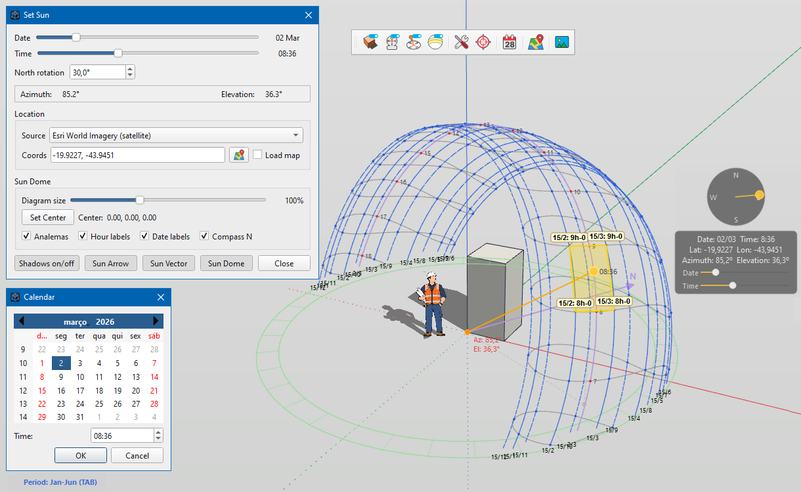
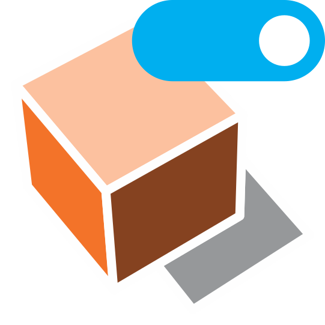
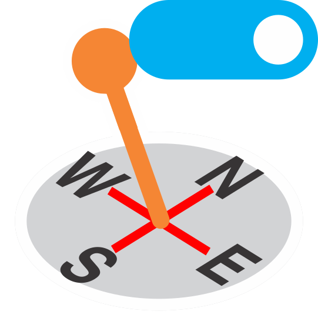
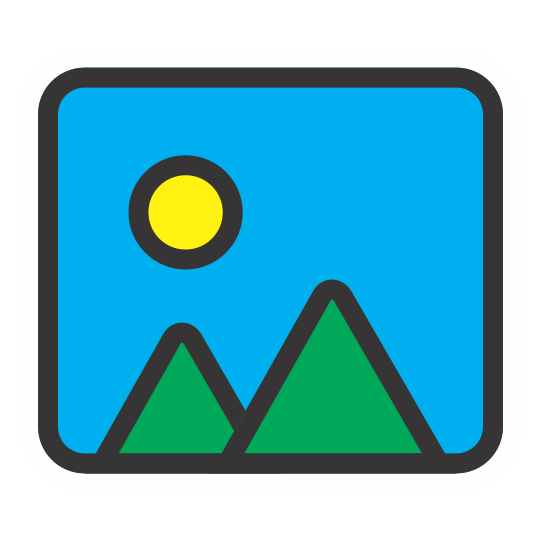

# igz_sunpath — "Sun Path" toolbar for IngeTrazo

**English** · [Português (Brasil)](README_ptBR.md)

A toolbar for [IngeTrazo](https://github.com/ingelibre/ingetrazo) that
provides a full **solar analysis** workbench: shadow toggle, date and
time sliders, calendar, a 3D **sun vector** with on-screen compass, a
dynamic **solar dome** (domus solar) with sun-path arcs and analemmas,
project-location controls integrated with IngeTrazo's **Terreno**
(Base Map) panel, and a **PNG export** of the current view.

- **Author:** Ezequiel M. Rezende
- **Repository:** <https://github.com/em-rezende/Ingetrazo-igz-sunpath>
- **Date:** 2026-10-18
- **Version:** 1.0.0
- **Tested with:** IngeTrazo 0.5.8 (Windows)
- **License:** [GPL-3.0-or-later](https://www.gnu.org/licenses/gpl-3.0.html)
  (same as IngeTrazo — see [LICENSE](LICENSE))

---



*The **Sun Path** toolbar on the top area — the shadow toggle, the
sun-arrow toggle, the sun-vector toggle, the dome toggle, the **Set Sun
Tool**, the **Set Center** pick, the **Calendar**, the **Set Location**
map picker and the **Save PNG** export. On the screen: the 3D **solar
dome** (sun-path arcs, red arc for the current day, analemmas, compass),
the **sun vector** (orange) with its projection (grey dashed) and the
**Azimut / Elevação** labels near the origin, the **Set Sun** dialog on
the left, the **Calendar** dialog below it and the **on-screen compass**
on the right with its **Date** / **Time** sliders.*

---

## Tools Overview

| Tool | Toolbar button | Icon | Description |
| --- | --- | --- | --- |
| **Shadows on/off** | Shadows on/off |  | Toggles IngeTrazo's native shadows on or off. Works exactly like the host's own shadow toggle, but from the Sun Path toolbar. |
| **Sun Arrow** | Sun Arrow |  | Shows/hides the **on-screen compass overlay** (top-right corner): rose with N/E/S/W, yellow dot at the sun's azimuth, info panel (date, time, lat, lon, azimuth, elevation) and the two **Date** / **Time** sliders. The whole overlay is draggable. |
| **Sun Vector** | Sun Vector |  | Shows/hides the **3D sun vector**: an orange ray from the dome's origin to the sun's current position, with a ball at the tip, a grey dashed projection to the XY plane and a small dot at the origin. Also shows `Az` / `El` labels next to the origin and a `HH:MM` label next to the ball. Automatically **rotated by `North offset`**. |
| **Sun Dome** | Sun Dome |  | Shows/hides the **solar dome** (domus solar): monthly sun-path arcs, the **current-day arc in red**, hour marks, sunrise/sunset date labels, analemmas and the ground compass. Cells between meridians are **clickable** — clicking sets date and time simultaneously, and switches on the **Sun Vector** (turns off **Sun Arrow**). Use **TAB** to switch the semester filter (Jan–Jun / Jul–Dec). |
| **Set Sun Tool** | Set Sun Tool |  | Opens the **Set Sun** dialog: date/time sliders, azimuth/elevation readout, north rotation, location box (source / coords / Set Location 🗺️ / Load map) and dome controls (diagram size, Set Center, analemmas/hours/dates/compass toggles) plus the four toggle buttons (Shadows on/off, Sun Arrow, Sun Vector, Sun Dome). |
| **Set Center** | Set Center |  | Enters **picking mode** to choose the dome's 3D origin by clicking anywhere in the viewport. The pick uses the host's **OSNAP engine** (vertices, edges, faces) — the `uses_snap` flag on the active tool is **temporarily patched to `True`** so the `SelectTool` resolves snap; it is restored when the pick finishes. A colored preview ball shows the snap type: yellow (vertex), cyan (edge), green (face), grey (plane). Cancel with **ESC** or **right-click**. |
| **Calendar** | Calendar |  | Opens a compact **calendar dialog** with a date picker and a `HH:mm` time editor. Both values are applied to `scene.shadows` immediately when you click **OK**. |
| **Set Location** | Set Location |  *(fallback 🗺️)* | Opens IngeTrazo's native **Terreno** map picker; applies the chosen latitude/longitude to `scene.georef` and refreshes the solar calculation. Optionally keeps the fetched map tiles (via the **Load map** checkbox in the dialog). |
| **Save PNG** | Save PNG |  | Opens a **mini-dialog with export options** (transparent background, yes/no), then a `QFileDialog`. Saves the current viewport to a **PNG**: in the **white** mode, the 3D model + solar overlay on a white background; in the **transparent** mode, **only the solar overlay** on a transparent background. Default filename is `sunpath_YYYYMMDD_HHmmss.png` in the user's *Pictures* folder; a confirmation is shown both in the status bar and in a message box. Works even if the IngeTrazo window is minimized. |

---

## Files

```
<plugins>/
└── igz_sunpath/
    ├── __init__.py              # package entry point (setup(app))
    ├── igz_sunpath.py           # "Sun Path" toolbar (main module)
    ├── README.md                # this file
    ├── README_ptBR.md           # Portuguese version
    ├── CHANGELOG.md             # release history
    ├── PUBLISHING.md            # release + catalog submission guide
    ├── LICENSE                  # full GPL-3.0 text
    ├── THIRD-PARTY.md           # third-party notices
    ├── icons/
    │   ├── sunpath_arrow.svg    / sunpath_arrow_light.svg
    │   ├── sunpath_calendar.svg / sunpath_calendar_light.svg
    │   ├── sunpath_center.svg   / sunpath_center_light.svg
    │   ├── sunpath_dome.svg     / sunpath_dome_light.svg
    │   ├── sunpath_map.svg      / sunpath_map_light.svg
    │   ├── sunpath_screenshot.svg  / sunpath_screenshot_light.svg
    │   ├── sunpath_shadows.svg  / sunpath_shadows_light.svg
    │   ├── sunpath_tool.svg     / sunpath_tool_light.svg
    │   └── sunpath_vector.svg   / sunpath_vector_light.svg
    ├── i18n/
    │   ├── en.json
    │   ├── pt-BR.json
    │   ├── de.json
    │   ├── es.json
    │   ├── fr.json
    │   ├── it.json
    │   └── zh-CN.json
    └── screenshots/
        └── igz_sunpath.png
```

The repository also carries the release tooling (not needed at runtime):

```
packaging/   build_extension.py / .ps1, igz_sunpath.toml
tests/       static tests + optional PySide6 GUI smoke test
.github/     GitHub Actions CI
```

---

## On-screen compass (overlay)

When **Sun Arrow** is on, a small overlay appears in the top-right
corner of the viewport. It is a **child QWidget** of the viewport, so it
floats above the 3D content without interfering with camera, selection
or zoom.

### Compass rose

- **Circle** with **N / E / S / W** cardinal labels.
- **Yellow dot + line** showing the sun's current azimuth, updated live
  with date and time.

### Info panel

Below the rose, a semi-transparent dark panel shows three lines:

```
Date: 05/02   Time: 09:30
Lat: -19,9167   Lon: -43,9345
Azimuth: 85,2º   Elevation: 36,3º
```

All values update in real time as the sliders or the dialog change.

### Date and Time sliders

Below the info text, **two thin sliders** let you scrub date and time
without opening the dialog:

- **Date** — horizontal slider spanning the whole year (day 1 → 365).
  Moving it **repositions the red arc** (current day) over the solar
  dome and re-renders the sun vector.
- **Time** — horizontal slider spanning 00:00 → 23:59. Moving it slides
  the sun's ball along the red arc.

Both sliders are **synchronised with the Set Sun dialog** and with the
solar dome: moving any of them (dialog or overlay) updates the others.

The whole overlay is **draggable** — click anywhere in the rose area and
drag to reposition it. The sliders and the info panel follow.

---

## "Set Sun" dialog

The dialog collects everything related to sun and site in one window.

### Date and time

| Control | Field affected | Range |
|---------|----------------|-------|
| **Date** slider | `scene.shadows.month` + `.day` | 1–365 (day of year) |
| **Time** slider | `scene.shadows.hour` + `.minute` | 0–1439 min |

### Info panel

- **Azimuth** and **Elevation** of the sun, in degrees, updated live
  with the date and time.

### North rotation

- **North rotation** spinbox (`0–360°`) — writes to **`scene.georef.north`**,
  the same field the IngeTrazo **Terreno** panel uses. Changing it
  rotates the dome, sun vector, compass **and** IngeTrazo's own model
  shadows on the next frame.

### Location box

| Control | Field affected | Range |
|---------|----------------|-------|
| **Source** combo | Terreno panel map source | Esri Imagery / Sentinel-2 cloudless / OpenStreetMap |
| **Coords** field | `scene.georef.lat` + `.lon` | editable text (`lat, lon`) |
| **Set Location** icon (🗺️) | Opens IngeTrazo's native map picker | — |
| **Load map** checkbox | Whether the fetched tiles are kept | on/off |

### Sun Dome box

*Visible only when **Sun Dome** is on.*

| Control | Field affected | Range |
|---------|----------------|-------|
| **Diagram size** slider | Scale of the dome in the world | 20–2000% |
| **Set Center** button | Dome origin (`_DOME_CENTER_XYZ`) | picks via OSNAP |
| **Center** label | Current dome origin (x, y, z) | read-only |
| **Analemas** checkbox | Show/hide the analemmas | on/off |
| **Hour labels** checkbox | Show/hide the hour numbers on the red arc | on/off |
| **Date labels** checkbox | Show/hide the date labels at sunrise/sunset | on/off |
| **Compass N** checkbox | Show/hide the two ground circles and the **N** arrow | on/off |

### Bottom buttons

| Button | What it does |
|--------|--------------|
| **Shadows on/off** | Toggles the host's native shadows (same as the toolbar action) |
| **Sun Arrow** | Shows/hides the on-screen compass overlay |
| **Sun Vector** | Shows/hides the 3D sun ray |
| **Sun Dome** | Shows/hides the solar dome |
| **Close** | Closes the dialog (changes are already persisted) |

### Persistence

Every change in the dialog is **persisted in the document**:

- Toggle states (`igz_dome_active`, `igz_sun_vector_active`,
  `igz_overlay_visible`), the diagram scale (`igz_dome_diagram_scale`),
  the four display flags (`igz_dome_show_*`), the dome origin
  (`igz_dome_center` as `[x, y, z]`) and the PNG export preference
  (`igz_export_transparent`) are stored **as attributes on the scene
  object** (with the `igz_` prefix).
- The **North offset** is stored in **`scene.georef.north`** — the same
  field the IngeTrazo **Terreno** panel uses, so it is fully
  interoperable with the host.
- The **date and time** are stored in **`scene.shadows`** — the same
  dataclass the IngeTrazo shadows toolbar uses.

Re-opening a saved `.igz` restores the exact same configuration,
**including the transparent-background preference**.

---

## Solar dome (domus solar)

The dome is drawn in **true 3D** over the viewport, projected with
IngeTrazo's own `viewport.world_to_pixel(QVector3D)` API — the same
call the host uses for its own overlays. This means the dome rotates
correctly with the camera, is clipped at the widget edges, and follows
every orbit / pan / zoom naturally.

### Elements

- **Sun-path arcs** — 12 arcs for the 15th of each month, plus one
  highlighted arc for the **current day** (see below):
  - **Continuous** for months **1–6** (southern-hemisphere summer and
    autumn, up to the June solstice).
  - **Dashed** for months **7–12** (southern-hemisphere winter and
    spring).
  - **All in blue** (`40, 90, 220`).
- **Current-day arc (red)** — a single extra arc drawn in **red**, at
  the exact date currently selected in the Set Sun dialog. This arc
  carries the **hour labels** (5…19) in dark grey next to each hour
  mark. Moving the Date slider (dialog or overlay) **repositions this
  arc** over the dome.
- **Hour marks** — small blue dots (radius 1.5 px) at every full hour
  (5h–19h) of each arc.
- **Date labels** — month/day (e.g. `15/3`) at the **sunrise** and
  **sunset** points of each arc, in black.
- **Analemmas** — 13 curves, one per full hour (6h–18h), each traced
  through a full year at 5-day steps (73 samples + closing point),
  drawn in medium grey. They produce the characteristic "figure-8"
  shapes. They can be toggled off via the **Analemas** checkbox.
- **Ground compass** — two concentric circles (R and 0.9 R) in
  light green, with **radial ticks every 10°** and a light-purple arrow
  pointing to the current **North**, labelled with a purple **N**.
- **Clickable cells** — quadrilaterals between consecutive monthly
  meridians (day 15) and consecutive whole hours. Hovering highlights
  the cell in yellow with its four `d/m: hh-0` labels; clicking sets
  date and time simultaneously and switches on **Sun Vector**.
- **Semester filter** — the **TAB** key toggles the set of months
  whose cells are active: **Jan–Jun** (default) or **Jul–Dec**. The
  currently active filter is shown as `Period: Jan-Jun (TAB)` /
  `Period: Jul-Dez (TAB)` in the bottom-left corner of the viewport.

### Solar math

The plugin computes the sun's position from **latitude**, **longitude**
and **date/time** using:

- **Solar declination** — standard astronomical approximation
  (`23.45° · sin(360° · (284 + doy) / 365)`).
- **Equation of time** — Spencer (1971) approximation
  (`9.87·sin(2B) − 7.53·cos(B) − 1.5·sin(B)`, B = 360·(doy − 81)/364),
  giving ±15 min of correction to the apparent solar time.
- **Local solar hour angle** from the true solar time.
- **Azimuth and elevation** from the standard spherical-trigonometry
  formulas. At the exact zenith the azimuth is undefined and the code
  fixes it to 0° to avoid numeric noise.

The result matches third-party references (e.g. Andrew Marsh's
[Sun-Path 2D](https://andrewmarsh.com/apps/releases/sunpath2d.html))
within ±0.5° on typical dates and latitudes.

### North rotation

`North rotation` (in the Set Sun dialog) writes to
**`scene.georef.north`** — the same field the IngeTrazo **Terreno**
panel exposes as *North*. As soon as the field changes,
**IngeTrazo's own model shadows also rotate**, because the host re-reads
that field on every frame.

Positive values rotate the North **clockwise** (matching the Terreno
panel), which makes the whole scene — dome, sun vector, compass,
shadows and **Az / El labels near the origin** — follow the new
orientation. The numeric **Azimuth** readout in the info panel remains
**geographic** (i.e., the sun's real angle from true North), independent
of the screen rotation.

### Diagram size

The `Diagram size` slider scales the dome from **20% to 2000%**
(0.20 → 20.0). The scale applies to the whole diagram (radius, compass,
sun vector, analemmas). The dome's cache is invalidated whenever the
scale changes, so there is no need to restart.

The **base radius** (`_DOME_BASE_RADIUS`, default 5.0 m in the source)
multiplied by the scale gives the effective radius in metres. At 100%,
the dome has a 10 m diameter; at 500%, 50 m; at 2000%, 200 m.

### Dome origin (Set Center)

The dome's origin can be placed anywhere in the model using **Set
Center** (toolbar button or the **Set Center** button inside the
dialog's *Sun Dome* box). The pick uses the host's **OSNAP engine**:

1. **`last_snap`** (if valid — kind ≠ `none`) — the exact point that
   IngeTrazo's OSNAP is currently showing under the cursor.
2. **`pick_vertex` / `pick_edge` / `pick_face`** — the host's own
   picking helpers, tried in that order of priority.
3. **`_snap_at`** — the snap engine itself (only accepted when
   `kind ≠ 'none'`).
4. **`_snap_to_scene_vertex`** — manual fallback that walks
   `scene.mesh` / `scene.faces` and returns the nearest vertex within
   a 12 px tolerance.
5. **`_world_under_cursor` / `_world_from_pixel`** — the flat work plane,
   as last resort.

Because `SelectTool` has `uses_snap=False`, the plugin **temporarily
patches** `uses_snap=True` on the active tool during the pick, then
restores the original value when the pick finishes (or is cancelled
with **ESC** / right-click). This is what makes the native OSNAP visual
marker appear during the pick.

The chosen point is stored as `igz_dome_center` in the scene
attributes (array `[x, y, z]`) and reflected in the `Center:` label.

---

## Export PNG

The **Save PNG** button opens a small **mini-dialog with export options**,
then a `QFileDialog`, then saves the current viewport to a **PNG**.

### Export options mini-dialog

Clicking **Save PNG** in the toolbar first opens a compact dialog:

- **Transparent background** checkbox (default: whatever the scene last
  remembered, i.e. `igz_export_transparent`).
- A hint: *"The image will include the viewport and the solar overlay."*
- **Continue** / **Cancel** buttons.

The preference chosen here is **persisted in the scene**
(`igz_export_transparent`), so it survives saving / reopening the
`.igz` file — and the next time you export, the checkbox starts in the
state you left it.

> **Note:** the *Transparent background* option is **not** in the *Set
> Sun* dialog — it lives in this mini-dialog, right in the export flow,
> which is the natural place for it.

### What is captured

**White background mode** (transparent checkbox **unchecked**):

- The **3D viewport** (model, terrain, shadows, camera).
- The **on-screen overlay** — compass rose, sun vector, dome,
  analemmas, Az/El labels, period indicator, snap preview ball (if
  picking).
- A **white** background.

**Transparent background mode** (transparent checkbox **checked**):

- **Only the on-screen overlay** — compass rose, sun vector, dome,
  analemmas, Az/El labels, period indicator, snap preview ball (if
  picking).
- A **transparent** background — the 3D model and terrain are
  **deliberately omitted**, so the overlay can be embedded into slides,
  posters, or dark-themed documents without a white box.

The dialog is **never** captured — the image only contains the viewport
(or just the overlay) and the solar graphics.

### How to export

1. Set up the scene — camera angle, date, time, dome toggles, north
   rotation, etc.
2. Click **Save PNG** in the toolbar.
3. In the mini-dialog, **check** or **uncheck** *Transparent
   background*, then click **Continue**.
4. The `QFileDialog` opens with the suggested name
   `sunpath_YYYYMMDD_HHmmss.png`, in **Pictures** (or the plugin folder
   as fallback).
5. Choose a location and click **Save**.
6. The image is rendered offscreen (viewport + overlay, or just the
   overlay) and saved.
7. A **confirmation message box** appears with the exact saved path,
   and the status bar shows the same message for 6 seconds.
8. If the save fails (permission denied, file locked, etc.), a message
   box with the reason appears — and, as a safety net, the plugin tries
   the system temporary folder and tells you if the fallback succeeded.

### Behaviour details

| Aspect | Behaviour |
|--------|-----------|
| **Size** | Exactly the viewport's current width × height in pixels (no scaling, no upsampling). |
| **Format** | PNG (lossless, supports transparency). |
| **White background** | Fills a `QPixmap` with `Qt.white`, renders the viewport, then draws the overlay. |
| **Transparent background** | Creates a `QImage` filled with `Qt.transparent`, renders **only the overlay** into it (the 3D viewport is not painted). |
| **Multi-monitor** | Irrelevant — the image is rendered into an offscreen `QPixmap` / `QImage`, not captured from the screen. |
| **Minimized window** | Works — `QWidget.render(...)` draws regardless of window visibility. |
| **Active pick mode** | The current snap preview ball is included. |
| **Overwrite** | `QFileDialog` prompts for confirmation before overwriting an existing file. |
| **File extension** | If the user types a name without extension, `.png` is appended automatically. |
| **Path normalization** | `os.path.normpath()` is applied before saving, so `D:/foo/bar.png` becomes `D:\foo\bar.png` on Windows. |
| **Fallback** | If the chosen path fails to save, the plugin tries `<temp>/igz_sunpath/<name>.png` and informs you via the confirmation box. |
| **Logging** | When `DEBUG = True`, the console prints `capture: saved <path> (WxH) transparent=<bool>`. |
| **Non-ASCII paths** | Fully supported (Qt uses UTF-16 internally). |
| **Icons in the image** | The toolbar and dialog icons are **not** part of the image. |

### Tips for high-quality output

- **Full HD screenshots** — resize the IngeTrazo window to at least
  1920×1080 before clicking **Save PNG**. The image will match the
  viewport pixel-for-pixel.
- **Reports on white paper** — leave **Transparent background**
  unchecked. The image will be the 3D model + overlay over white.
- **Embedding in slides with dark theme** — check **Transparent
  background**. Only the dome and labels will be in the image; the
  model's 3D faces will not. If you need the 3D model with a
  transparent background, that is not supported by the current viewport
  (the host paints its own opaque background before the extension can
  draw).
- **Documenting the picked origin** — leave **Set Center** picking
  active (with the colored preview ball visible) when you click
  **Save PNG**; the ball will be part of the image.

---

## Icons & themes

Each button ships **two icon variants**, so the toolbar stays legible on
both dark and light interfaces:

- `sunpath_<name>.svg` — the default variant (used on dark themes).
- `sunpath_<name>_light.svg` — the light-theme variant.

At start-up, `_load_themed_icon()` inspects the `QPalette.Window` colour
of the main window. On a **light** UI it loads the `_light.svg` file when
it exists and otherwise falls back to the default icon; on a dark UI it
always uses the default one. No configuration is required — the icons
follow the application theme automatically.

The **Set Location** button uses the emoji `🗺️` as fallback, so it works
even without any icon file. The **Save PNG** button uses
`sunpath_screenshot.svg` (or its `_light` variant).

---

## Internationalization

The plugin ships its own **JSON catalogs** in `i18n/`, one per supported
language:

| File | Language |
|------|----------|
| `en.json`    | English (US) |
| `pt-BR.json` | Português (Brasil) |
| `de.json`    | Deutsch |
| `es.json`    | Español |
| `fr.json`    | Français |
| `it.json`    | Italiano |
| `zh-CN.json` | 简体中文 |

The catalog is loaded at runtime based on IngeTrazo's current language
(`core.i18n.current_language()`); missing keys fall back to `en.json`.
A 1-second timer watches for language changes and re-labels the toolbar,
the Set Sun dialog and the Az/El labels of the overlay instantly.

To add a new language, drop a `<code>.json` file in `i18n/` with the same
keys as `en.json`.

The PNG export uses the following keys (all present in `en.json` and in
all 6 other catalogs):

- `"Save PNG"` — mini-dialog title.
- `"Export options"` — section header.
- `"Transparent background"` — checkbox label.
- `"If checked, the exported PNG will have a transparent background."` —
  checkbox tooltip.
- `"The image will include the viewport and the solar overlay."` —
  hint line.
- `"Continue"` — accept button.
- `"Cancel"` — reject button.
- `"Could not save the image to:\n{path}\n\nDetails:\n{details}"` —
  failure message with the diagnostic details.
- `"Image saved: {path}"` — success message.
- `"Image saved (fallback): {path}"` — success message when the
  fallback path (the system temporary folder) was used.

---

## Compatibility with the IngeTrazo plugin API

IngeTrazo states in
[`docs/plugins.md`](https://github.com/ingelibre/ingetrazo/blob/main/docs/plugins.md):

> The plugin API is **not stable yet** — expect breaking changes during
> the 0.x series.

The plugin **works** in IngeTrazo 0.5.8 but uses a few points
that are **not part of the public extension API**. Consolidated list:

| Symbol | Where | Why |
|---|---|---|
| `viewport.scene.shadows` | `_get_shadows` | Internal chain; the scene is not on `app.scene` |
| `ShadowSettings.{enabled, month, day, hour, minute, darkness}` | various | Internal dataclass (`core.sun`) |
| `scene.georef.{lat, lon, north}` | `_read_georef_from_scene` / `_read_north_rotation` | Internal dataclass (`SceneDatum`) |
| `viewport.world_to_pixel(QVector3D)` | every painter draw | Public API for extensions, but not in `plugins.md` |
| `viewport.{_snap_at, last_snap, pick_vertex, pick_edge, pick_face, _world_under_cursor, _world_from_pixel}` | `_pick_with_osnap` | Internal snap engine; used by **Set Center** |
| `viewport.active_tool.uses_snap` | `_patch_uses_snap_for_picking` | Internal flag; temporarily patched to `True` during **Set Center** |
| `BaseMapPanel` internals (`_source`, `_find`, `_lat`, `_lon`, `_last_sid`) | `_open_native_georef_dialog` | Reached through `findChildren`; the **Terreno** panel is not a public API |
| `scene.{tile_layer, terrain, photo_mesh}` snapshot | `_open_native_georef_dialog` | Internal scene attributes, restored when *Load map* is off |
| `QToolBar` + `MainWindow.addToolBar(...)` | `_create_sunpath_toolbar` | Horizontal toolbars have no official API in the 0.x series |
| Widget overlay (`_SunArrowOverlay` as a child of `viewport`) | `_ensure_overlay` | Not covered by `plugins.md`; relies on the viewport being a plain `QWidget` |
| `QWidget.render(QPainter, QPoint)` / `QWidget.render(QPaintDevice)` | `_capture_viewport_to_png` | Qt public API, but relies on the viewport being a plain `QWidget` (which it currently is). **PySide6 ≥ 6.4 requires the `targetOffset`** `QPoint(0, 0)` on the `render(QPainter)` overload. |

### What **is** compliant with `plugins.md`

- `.py` file in the correct plugins folder.
- Defines module-level `setup(app)`.
- Fault-tolerant: any exception inside the callbacks is caught and
  logged — the app keeps running.
- Does not modify the document without going through the scene's own
  data structures.
- Does not assume `sys.path` and does not import its own package.
- Respects threading (everything on the main thread).
- Uses **public Qt APIs** (`QFileDialog`, `QPixmap`, `QImage`,
  `QStandardPaths`, `QDateTime`) for the PNG export — nothing internal.

### What is **not** covered by `plugins.md`

- Horizontal toolbars have **no official API** in the 0.x version. The
  document mentions `app.add_panel(...)` (side tab),
  `app.add_menu_action(...)` (menu entry), and `app.add_context_menu(...)`,
  but not `add_toolbar(...)`. This extension uses `QToolBar` **directly
  via PySide** — it works, but it is the "informal" path.
- There is no subclass of `tools.base.Tool`. This means the plugin
  **does not appear in the Extensions menu**, has no shortcut, and is not
  in the F3 search. If that is desired, see "Future improvements" below.
- No persistence via `app.document_data`. The plugin's own state is
  stored directly on the scene object (see the **Persistence** section),
  which survives the current session but is not part of a formal API.

### If the 0.x API breaks

- **Georef / North:** `scene.georef.lat`, `.lon`, `.north` → check whether
  `app.scene` starts exposing the scene directly.
- **Projection:** `viewport.world_to_pixel` → if a formal API appears,
  migrate.
- **Toolbar:** `QToolBar` → if `app.add_toolbar(...)` appears, migrate.
- **Overlay:** the on-screen compass uses a `QWidget` child of the
  viewport; if IngeTrazo ever changes the viewport class away from a
  plain `QWidget`, the overlay would have to be re-parented or replaced
  by a native overlay hook. **The same applies to the PNG export**,
  which calls `viewport.render(pixmap)` — a method of `QWidget`.
- **Set Center / OSNAP:** `_pick_with_osnap` relies on
  `viewport.{_snap_at, last_snap, pick_vertex, pick_edge, pick_face}` and
  on the `uses_snap` flag. If any of these disappear, the pick falls
  back to `_snap_to_scene_vertex` and then to the work plane.

---

## Installation

### Manual (IngeTrazo 0.5.8)

1. Download `igz_sunpath.zip` from the
   [latest release](https://github.com/em-rezende/Ingetrazo-igz-sunpath/releases/latest)
   and unpack it.
2. Locate IngeTrazo's plugins folder:
   - **Linux:** `~/.local/share/ingetrazo/plugins/`
   - **Windows:** `%APPDATA%\ingetrazo\plugins\`
   - Or use the **Extensions ▸ Open plugins folder** menu.
3. Move the unpacked **`igz_sunpath`** folder into that plugins folder, so
   the files end up at `<plugins>/igz_sunpath/` (it holds `__init__.py`,
   the main module, the docs, the `icons/` and `i18n/` folders).
4. Restart IngeTrazo.

The **Sun Path** toolbar appears in the top area, next to the other
toolbars.

### From the IngeTrazo extension catalog

Once the entry is listed in the community catalog at
<https://ingetrazo.com/extensiones>, the extension can be installed from
**Extensions ▸ Manage extensions…** (the manager in 0.5.8 installs from
that catalog; it has no file picker). The unmodified catalog entry is
[`packaging/igz_sunpath.toml`](packaging/igz_sunpath.toml), and
[`PUBLISHING.md`](PUBLISHING.md) has the release and submission steps.

---

## Development

```powershell
# Static checks (no Qt needed): syntax, i18n, icons, links, catalog,
# deterministic ZIP layout and hash.
python -m unittest discover -s tests -v

# Optional GUI smoke test, if PySide6 can be imported (offscreen).
python -m unittest tests.test_gui_smoke -v

# Build dist/igz_sunpath.zip and refresh packaging/igz_sunpath.toml.
python packaging/build_extension.py --write-catalog
python packaging/build_extension.py --check
```

The plugin has a single module, `igz_sunpath.py`, split into numbered
sections; `__init__.py` only exposes `setup(app)`. `DEBUG = False` in
releases — set it to `True` locally to log to stderr.

---

## Usage

### Shadows on/off
- Click **Shadows on/off** to toggle IngeTrazo's native shadows. The
  toolbar button and the dialog button stay synchronised — both read
  `scene.shadows.enabled`.

### Sun Arrow + on-screen compass
- Click **Sun Arrow** to show the on-screen compass — a small circle in
  the top-right corner of the viewport with N/E/S/W labels and a yellow
  dot showing where the sun is right now.
- The panel below the compass shows date, time, latitude, longitude,
  azimuth and elevation.
- Two sliders below the panel let you scrub **Date** and **Time**
  directly in the viewport, without opening the dialog.
- Drag the compass (anywhere in the rose area) to reposition it.

### Sun Vector
- Click **Sun Vector** to show the 3D sun ray: an orange line from the
  dome's origin to the sun's current position, with a ball at the tip
  and a small dot at the origin. A short grey dashed line drops from the
  sun to the XY plane, and from there to the origin, showing the sun's
  projection on the ground.
- The current time is displayed next to the orange ball.
- `Az:` and `El:` labels are drawn near the origin, in a two-line stack,
  in the same color as the sun vector. Both values are **geographic**
  (independent of `North rotation`).
- Both the tip and the labels **rotate together** with `North rotation`,
  so the vector is always aligned with the red arc of the dome.

### Solar Dome
- Click **Sun Dome** to show the whole dome: sun-path arcs, analemmas,
  hour marks, sunrise/sunset labels and the ground compass.
- A **red arc** highlights the **current day** and carries the hour
  labels (5…19).
- **Hover a cell** between meridians and hours — it is highlighted in
  yellow with four `d/m: hh-0` labels at its corners.
- **Click a cell** to set the date and time simultaneously. The plugin
  turns off **Sun Arrow** (if on) and turns on **Sun Vector** (if off),
  so you immediately see the chosen sun position.
- Press **TAB** to switch the semester filter (Jan–Jun ↔ Jul–Dec). The
  active filter is shown as `Period: Jan-Jun (TAB)` / `Period: Jul-Dez (TAB)`.
- Open **Set Sun Tool** to control the dome: scale, hour labels, date
  labels, compass, analemma visibility, north rotation and set center.
- Change the **date** or **time** — either in the dialog or in the
  on-screen compass sliders — and the whole dome updates instantly,
  including the position of the red arc.
- Change the **latitude/longitude** in the Location box (or via the
  **Set Location** toolbar button) and the dome reorients to the new
  site immediately.

### Set Center
- Click **Set Center** (toolbar or the **Set Center** button inside the
  *Sun Dome* box) to enter picking mode.
- Move the mouse over the model: the OSNAP engine of the host lights up
  (vertices, edges, faces) and the overlay preview ball shows the current
  snap type — **yellow** (vertex), **cyan** (edge), **green** (face),
  **grey** (plane).
- Click to confirm. The dome is re-centered on that point.
- Press **ESC** or **right-click** to cancel without changing the
  origin.
- The chosen point is stored as `igz_dome_center` and survives a save /
  reload of the `.igz` file.

### Set Location
- Click **Set Location** (🗺️) to open IngeTrazo's native **Terreno**
  map picker. Choose a place, and the latitude/longitude are applied to
  the scene. The dome and the sun vector recalculate automatically.
- The 🗺️ icon is right next to the **Coords** field in the Set Sun
  dialog. The same action is also available from the toolbar (the last
  button before **Save PNG**).

### Calendar
- Click **Calendar** to open a small calendar dialog with a `HH:mm`
  time editor. Both values are applied to `scene.shadows` when you click
  **OK**, and the on-screen compass sliders stay synchronised.

### Save PNG
1. Set up the scene — camera angle, date, time, dome toggles, north
   rotation, etc.
2. Click **Save PNG** in the toolbar.
3. In the mini-dialog, check or uncheck **Transparent background**,
   then click **Continue**.
4. The file dialog opens with the suggested name
   `sunpath_YYYYMMDD_HHmmss.png`, in **Pictures** (or the plugin folder
   as fallback).
5. Choose a location and click **Save**.
6. The image is rendered offscreen and saved. A **message box** appears
   with the exact saved path; the status bar shows the same message
   for 6 seconds.
7. If the save fails (e.g., permission denied), the plugin tries a
   fallback in the system temporary folder and reports the outcome.
8. If the current **Set Center** pick mode is active, the colored preview
   ball is included in the image — useful for documenting the picked
   point.

---

## Future improvements (optional)

Everything `plugins.md` recommends that is **not** implemented yet.
None of these improvements are required — the plugin works fine
without them.

1. **`Tool` subclass**: "Sun Path…" in the Extensions menu, with a
   shortcut. Lets the user reopen the toolbar if it gets closed.

2. **High-resolution PNG export**: add a "Resolution" dropdown to the
   export options (1×, 2×, 4×). The dome is vector, so a 2× or 4× render
   keeps the labels and arcs crisp on print. Implementation would
   render to a `QPixmap` of `w*scale × h*scale` after `painter.scale()`.

3. **Copy image to clipboard**: a second toolbar action "Copy PNG" that
   pushes the rendered `QPixmap` to `QApplication.clipboard()`, so the
   user can paste directly into chat / e-mail without saving a file.

4. **Export as SVG**: render the overlay into a `QSvgGenerator`
   instead of a `QPixmap`, giving a fully vector output (the viewport
   3D content would still be raster).

5. **Additional projections**: offer a 2D **stereographic** sun-path
   diagram (like Andrew Marsh's tool) as an alternative to the 3D dome,
   for users who prefer classic solar charts.

6. **Multi-day highlight**: show several consecutive days as red arcs
   (e.g. a ±3-day window), for thermal-mass analysis.

7. **Time zone control**: expose `utc_offset` in the Set Sun dialog
   (the field exists in `ShadowSettings` but is not user-editable today).

8. **Formal persistence**: move the `igz_*` scene attributes into
   `app.document_data` once the host exposes it, so the state is stored
   in a documented location rather than as dynamic attributes.

9. **Toolbar reattach**: when the host re-creates the toolbars, the Sun
   Path toolbar should reattach automatically instead of relying on a
   restart.

---

## License

GPL-3.0-or-later — the same license as IngeTrazo.
Third-party notices are recorded in [THIRD-PARTY.md](THIRD-PARTY.md).

See <https://www.gnu.org/licenses/gpl-3.0.html>.

Copyright (C) 2026 Ezequiel M. Rezende.

This program is free software: you can redistribute it and/or modify it
under the terms of the GNU General Public License, version 3 or later,
as published by the Free Software Foundation.

This program is distributed in the hope that it will be useful, but
**without any warranty**; without even the implied warranty of
**merchantability** or **fitness for a particular purpose**. See the
GNU General Public License for more details.
