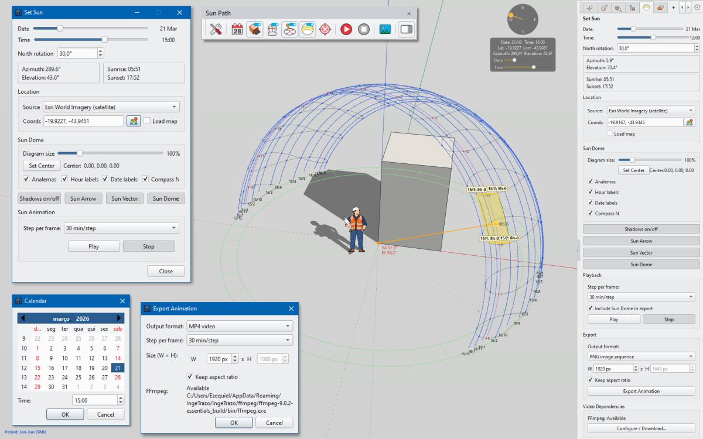
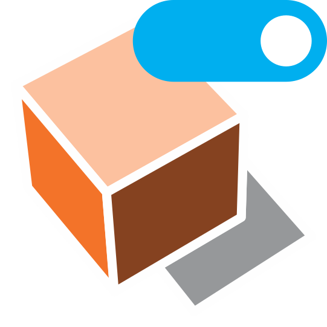
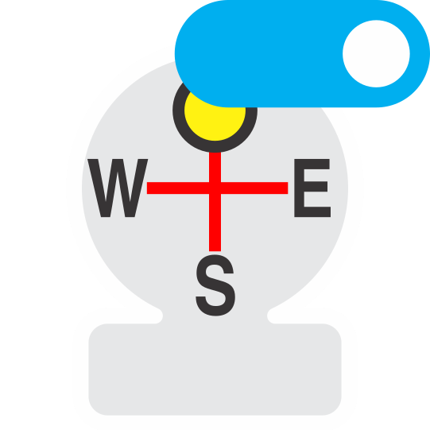
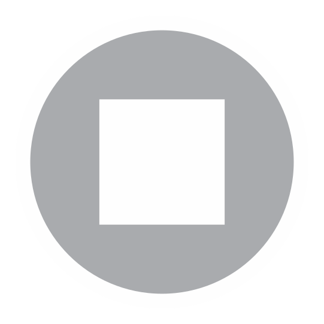
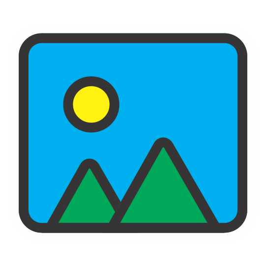
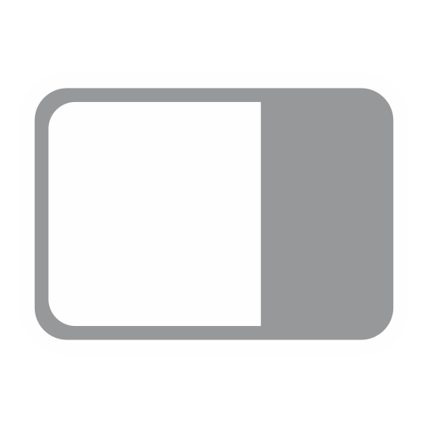

# igz_sunpath — Barra "Sun Path" para o IngeTrazo

[English](README.md) · **Português (Brasil)**

Uma barra de ferramentas e um painel lateral para o
[IngeTrazo](https://github.com/ingelibre/ingetrazo) que fornecem um
ambiente completo de **análise solar**: alternância de sombras, sliders
de data e hora, calendário, um **vetor solar** 3D com bússola em tela,
um **domo solar** dinâmico (domus solar) com arcos de trajetória do sol
e analemas, controles de localização do projeto integrados ao painel
**Terreno** (Base Map) do IngeTrazo, **animação** do sol ao longo da sua
trajetória, e **exportação de sequência PNG / vídeo MP4** da viewport
animada.

- **Autor:** Ezequiel M. Rezende
- **Repositório:** <https://github.com/em-rezende/Ingetrazo-igz-sunpath>
- **Data:** 2026-11-16
- **Versão:** 1.1.0
- **Testado com:** IngeTrazo 0.5.8 (Windows)
- **Licença:** [GPL-3.0-or-later](https://www.gnu.org/licenses/gpl-3.0.html)
  (a mesma do IngeTrazo — veja [LICENSE](LICENSE))

---



*A barra **Sun Path** na área superior — toggle de sombras, toggle da
seta do sol, toggle do vetor solar, toggle do domo, **Ajustar Sol**, **Definir Centro**,
**Calendário**, **Exportar Sequência / Vídeo** e **Painel do Sol**. Na
tela: o **domo solar** 3D (arcos de trajetória, arco vermelho do dia
atual, analemas, bússola), o **vetor solar** (laranja) com sua projeção
(traço tracejado cinza) e os rótulos **Az / El** próximos à origem, a
**bússola em tela** à direita com seus sliders de **Data** / **Hora**, o
diálogo **Ajustar Sol** à esquerda e o **painel lateral** à direita.*

---

## Visão geral das ferramentas

| Ferramenta | Botão da barra | Ícone | Descrição |
| --- | --- | --- | --- |
| **Ajustar Sol** | Set Sun |  | Abre o diálogo **Ajustar Sol**: sliders de data/hora, leitura de azimute/elevação, rotação do norte, caixa de localização (fonte / coords / Definir Localização / Carregar mapa) e controles do domo (tamanho do diagrama, Definir Centro, toggles de analemas/horas/datas/bússola), além dos quatro botões de alternância (Sombras on/off, Seta do Sol, Vetor Solar, Domo Solar) e dos controles de **animação** (Play / Stop, passo por quadro). |
| **Calendário** | Calendar |  | Abre um **diálogo compacto de calendário** com seletor de data e editor de hora `HH:mm`. Ambos os valores são aplicados a `scene.shadows` imediatamente ao clicar em **OK**. |
| **Sombras on/off** | Shadows on/off |  | Liga ou desliga as sombras nativas do IngeTrazo. Fica sincronizado com o botão do diálogo e o do painel lateral. |
| **Seta do Sol** | Sun Arrow |  | Mostra/oculta a **bússola em tela** (canto superior direito): rosa dos ventos com N/L/S/O, ponto amarelo na posição do sol, painel de informação (data, hora, lat, lon, azimute, elevação) e os dois sliders de **Data** / **Hora**. Todo o overlay é arrastável. |
| **Vetor Solar** | Sun Vector |  | Mostra/oculta o **vetor solar 3D**: um raio laranja da origem do domo até a posição atual do sol, com uma bola na ponta, uma projeção tracejada cinza até o plano XY e um pequeno ponto na origem. Também desenha os rótulos `Az` / `El` próximo à origem e a hora `HH:MM` próximo à bola. É **rotacionado automaticamente** pela `Rotação do norte`. |
| **Domo Solar** | Sun Dome |  | Mostra/oculta o **domo solar** (domus solar): arcos mensais de trajetória, o **arco do dia atual em vermelho**, marcas horárias, rótulos de nascer/pôr do sol, analemas e a bússola de solo. As células entre meridianos são **clicáveis** — clicar define data e hora simultaneamente e liga o **Vetor Solar** (desliga a **Seta do Sol**). Use **TAB** para alternar o filtro de semestre (Jan–Jun / Jul–Dez). |
| **Play** | Play |  *(fallback ▶️)* | Inicia a **animação do sol** — avança a hora em passos (60, 30, 15, 10, 5 ou 1 min por quadro, configurável no diálogo ou no painel lateral) até o pôr do sol. O overlay, o vetor e o domo atualizam ao vivo. |
| **Stop** | Stop |  *(fallback ⏹️)* | Para a animação em execução. |
| **Exportar Sequência / Vídeo** | Export Sequence / Video |  | Abre o **ExportDialog**: escolha formato de saída (sequência de imagens PNG ou vídeo MP4), tamanho (L × A), manter proporção, incluir domo, passo por quadro, e então um seletor de arquivo/pasta. A animação roda e salva os quadros (PNG) ou renderiza o MP4. |
| **Painel do Sol** | Sun Panel |  *(fallback sunpath_center.svg)* | Mostra/oculta o **painel lateral** (dock) — uma versão compacta e sempre visível dos controles do Ajustar Sol: sliders de data/hora, rotação do norte, caixa de localização, controles do domo, controles de animação, configurações de exportação e status do FFmpeg. Os componentes do painel são **dinâmicos em largura** — acompanham o dock quando o usuário o redimensiona. |

---

## Painel lateral

O botão **Painel do Sol** na barra mostra um dock lateral com layout
**responsivo e rolável**. Diferente do diálogo flutuante, o painel
lateral foi feito para ficar aberto enquanto você trabalha — seus
componentes (sliders, combos, spin boxes, line edits) **esticam e
encolhem junto com a largura do dock**, graças a um polimento de largura
dinâmica aplicado após a construção e reaplicado no resize.

O painel contém:

- Sliders de **Data** e **Hora** (com o valor atual exibido).
- Spin box de **Rotação do norte**.
- Leituras de **Azimute / Elevação** e **Nascer / Pôr do sol**.
- Caixa de **Localização**: combo de fonte, coordenadas editáveis,
  ícone **Definir Localização**, checkbox **Carregar mapa**.
- Caixa do **Domo Solar** (visível somente quando o domo está ligado):
  tamanho do diagrama, Definir Centro, toggles de Analemas / Rótulos de
  hora / Rótulos de data / Bússola N.
- Os quatro botões de alternância: **Sombras on/off**, **Seta do Sol**,
  **Vetor Solar**, **Domo Solar**.
- **Reprodução**: passo por quadro (combo), checkbox **Incluir Domo do
  Sol na exportação**, botões **Play** / **Stop**.
- **Exportação**: formato de saída (sequência PNG / vídeo MP4), tamanho
  L × A, **Manter proporção da tela**, botão **Exportar Animação**.
- **Dependências de Vídeo**: status do FFmpeg (`Disponível` /
  `AUSENTE`) e botão **Configurar / Baixar...** que abre o gerenciador
  do FFmpeg.

---

## Bússola em tela (overlay)

Quando **Seta do Sol** está ligada, um pequeno overlay aparece no canto
superior direito da viewport. É um **QWidget filho** da viewport, então
flutua sobre o conteúdo 3D sem interferir com a câmera, seleção ou zoom.

### Rosa dos ventos

- **Círculo** com rótulos cardeais **N / L / S / O**.
- **Ponto amarelo + linha** mostrando o azimute atual do sol, atualizado
  ao vivo com data e hora.

### Painel de informação

Abaixo da rosa dos ventos, um painel escuro semi-transparente mostra três
linhas:

```
Data: 05/02   Hora: 09:30
Lat: -19,9167   Lon: -43,9345
Azimute: 85,2º   Elevação: 36,3º
```

Todos os valores são atualizados em tempo real conforme os sliders ou o
diálogo mudam.

### Sliders de Data e Hora

Abaixo do texto informativo, **dois sliders finos** permitem varrer data
e hora sem abrir o diálogo:

- **Data** — slider horizontal cobrindo o ano inteiro (dia 1 → 365).
  Movê-lo **reposiciona o arco vermelho** (dia atual) sobre o domo solar
  e re-renderiza o vetor solar.
- **Hora** — slider horizontal cobrindo 00:00 → 23:59. Movê-lo desliza
  a bola do sol ao longo do arco vermelho.

Ambos os sliders são **sincronizados com o diálogo Ajustar Sol, o painel
lateral e o domo solar** — mover qualquer um deles atualiza os demais.

Todo o overlay é **arrastável** — clique em qualquer ponto da área da
rosa e arraste para reposicioná-lo. Os sliders e o painel de informação
acompanham.

---

## Diálogo "Ajustar Sol"

O diálogo reúne em uma só janela tudo o que é relacionado ao sol e ao
local.

### Data e hora

| Controle | Campo afetado | Faixa |
|---------|---------------|-------|
| Slider **Data** | `scene.shadows.month` + `.day` | 1–365 (dia do ano) |
| Slider **Hora** | `scene.shadows.hour` + `.minute` | 0–1439 min |

### Painel de informação

- **Azimute** e **Elevação** do sol, em graus, atualizados ao vivo com a
  data e a hora.
- Horários de **Nascer** e **Pôr do sol** (ou `--:--` quando o sol não
  nasce/põe, ex.: dia/noite polar).

### Rotação do norte

- Spin box **Rotação do norte** (`0–360°`) — escreve em
  **`scene.georef.north`**, o mesmo campo que o painel **Terreno** do
  IngeTrazo usa. Alterá-lo rotaciona o domo, o vetor solar, a bússola
  **e** as sombras nativas do modelo do IngeTrazo no quadro seguinte.

### Caixa de localização

| Controle | Campo afetado | Faixa |
|---------|---------------|-------|
| Combo **Fonte** | Fonte de mapa do painel Terreno | Esri Imagery / Sentinel-2 cloudless / OpenStreetMap |
| Campo **Coordenadas** | `scene.georef.lat` + `.lon` | texto editável (`lat, lon`) |
| **Definir Localização** (ícone) | Abre o seletor de mapa nativo do IngeTrazo | — |
| Checkbox **Carregar mapa** | Se os tiles baixados são mantidos | on/off |

### Caixa do Domo Solar

*Visível somente quando **Domo Solar** está ligado.*

| Controle | Campo afetado | Faixa |
|---------|---------------|-------|
| Slider **Tamanho do diagrama** | Escala do domo no mundo | 20–2000% |
| Botão **Definir centro** | Origem do domo (`_DOME_CENTER_XYZ`) | pick via OSNAP |
| Rótulo **Centro** | Origem atual do domo (x, y, z) | somente leitura |
| Checkbox **Analemas** | Mostrar/ocultar os analemas | on/off |
| Checkbox **Rótulos de hora** | Mostrar/ocultar as horas no arco vermelho | on/off |
| Checkbox **Rótulos de data** | Mostrar/ocultar as datas em nascer/pôr do sol | on/off |
| Checkbox **Bússola N** | Mostrar/ocultar os círculos de solo e a seta **N** | on/off |

### Controles de animação

| Controle | Campo afetado | Faixa |
|---------|---------------|-------|
| Combo **Passo por quadro** | `SunAnimator.speed` (minutos/tick) | 60, 30, 15, 10, 5, 1 min |
| Botão **Play** | Inicia a animação (avança até o pôr do sol) | — |
| Botão **Stop** | Para a animação | — |

> A animação é o **slider de hora se movendo sozinho**. É o que o fluxo
> **Exportar Sequência / Vídeo** usa por baixo dos panos.

### Botões inferiores

| Botão | O que faz |
|-------|-----------|
| **Sombras on/off** | Alterna as sombras nativas do host (mesmo que a ação da barra) |
| **Seta do Sol** | Mostra/oculta a bússola em tela |
| **Vetor Solar** | Mostra/oculta o vetor solar 3D |
| **Domo Solar** | Mostra/oculta o domo solar |
| **Fechar** | Fecha o diálogo (as alterações já estão persistidas) |

### Persistência

Toda alteração feita no diálogo é **persistida no documento**:

- Estados de alternância (`igz_dome_active`, `igz_sun_vector_active`,
  `igz_overlay_visible`), a escala do diagrama
  (`igz_dome_diagram_scale`), as quatro flags de exibição
  (`igz_dome_show_*`), a origem do domo (`igz_dome_center` como
  `[x, y, z]`), as preferências de exportação
  (`igz_export_transparent`, `igz_export_keep_ratio`, `igz_export_size`,
  `igz_export_include_dome`) e o passo da animação
  (`igz_animation_step_minutes`) são armazenados **como atributos do
  objeto scene** (com o prefixo `igz_`).
- A **rotação do norte** é armazenada em **`scene.georef.north`** — o
  mesmo campo usado pelo painel **Terreno** do IngeTrazo, portanto é
  totalmente interoperável com o host.
- A **data e a hora** são armazenadas em **`scene.shadows`** — o mesmo
  dataclass usado pela barra de sombras do IngeTrazo.

Reabrir um `.igz` salvo restaura exatamente a mesma configuração,
**inclusive as preferências de exportação e animação**.

---

## Domo solar (domus solar)

O domo é desenhado em **3D verdadeiro** sobre a viewport, projetado com
a API `viewport.world_to_pixel(QVector3D)` do próprio IngeTrazo — a mesma
chamada que o host usa em seus próprios overlays. Isso significa que o
domo rotaciona corretamente com a câmera, é recortado nas bordas do
widget e acompanha naturalmente qualquer órbita / pan / zoom.

### Elementos

- **Arcos de trajetória** — 12 arcos, um para o dia 15 de cada mês,
  mais um arco destacado para o **dia atual** (veja abaixo):
  - **Contínuo** para os meses **1–6** (verão e outono do hemisfério
    sul, até o solstício de junho).
  - **Tracejado** para os meses **7–12** (inverno e primavera do
    hemisfério sul).
  - **Todos em azul** (`40, 90, 220`).
- **Arco do dia atual (vermelho)** — um arco extra desenhado em
  **vermelho**, na data exata selecionada no diálogo Ajustar Sol. Esse
  arco carrega os **rótulos de hora** (5…19) em cinza escuro ao lado de
  cada marca horária. Mover o slider de Data (diálogo, overlay ou painel
  lateral) **reposiciona este arco** sobre o domo.
- **Marcas horárias** — pequenos pontos azuis (raio 1,5 px) em cada hora
  cheia (5h–19h) de cada arco.
- **Rótulos de data** — mês/dia (por exemplo `15/3`) nos pontos de
  **nascer** e **pôr do sol** de cada arco, em preto.
- **Analemas** — 13 curvas, uma para cada hora cheia (6h–18h), cada uma
  traçada ao longo de um ano inteiro em passos de 5 dias (73 amostras +
  ponto de fechamento), desenhadas em cinza médio. Produzem as
  características formas de "oito". Podem ser desligados pelo checkbox
  **Analemas**.
- **Bússola de solo** — dois círculos concêntricos (R e 0,9 R) em verde
  claro, com **marcas radiais a cada 10°** e uma seta lilás apontando
  para o **Norte** atual, rotulada com um **N** roxo.
- **Células clicáveis** — quadriláteros entre meridianos mensais
  consecutivos (dia 15) e horas cheias consecutivas. Passar o mouse
  destaca a célula em amarelo com seus quatro rótulos `d/m: hh-0`;
  clicar define data e hora simultaneamente e liga o **Vetor Solar**.
- **Filtro de semestre** — a tecla **TAB** alterna o conjunto de meses
  cujas células estão ativas: **Jan–Jun** (padrão) ou **Jul–Dez**. O
  filtro ativo é exibido como `Período: Jan-Jun (TAB)` /
  `Período: Jul-Dez (TAB)` no canto inferior esquerdo da viewport.

### Matemática solar

O plugin calcula a posição do sol a partir de **latitude**,
**longitude** e **data/hora** usando:

- **Declinação solar** — aproximação astronômica padrão
  (`23,45° · sin(360° · (284 + doy) / 365)`).
- **Equação do tempo** — aproximação de Spencer (1971)
  (`9,87·sin(2B) − 7,53·cos(B) − 1,5·sin(B)`, B = 360·(doy − 81)/364),
  resultando em ±15 min de correção em relação ao tempo solar aparente.
- **Ângulo horário solar local** a partir do tempo solar verdadeiro.
- **Azimute e elevação** pelas fórmulas padrão de trigonometria
  esférica. No zênite exato o azimute é indefinido e o código o fixa em
  0° para evitar ruído numérico.
- **Nascer / pôr do sol** a partir de `cos(H) = −tan(lat)·tan(dec)`.
  Quando |cos(H)| > 1 (dia/noite polar), a função retorna `None` e o
  diálogo mostra `--:--`.

O resultado concorda com referências de terceiros (por exemplo o
[Sun-Path 2D](https://andrewmarsh.com/apps/releases/sunpath2d.html) de
Andrew Marsh) dentro de ±0,5° em datas e latitudes típicas.

### Rotação do norte

`Rotação do norte` (no diálogo Ajustar Sol ou no painel lateral) escreve
em **`scene.georef.north`** — o mesmo campo que o painel **Terreno** do
IngeTrazo expõe como *Norte*. Assim que o campo muda, **as sombras
nativas do modelo do IngeTrazo também rotacionam**, porque o host relê
esse campo a cada quadro.

Valores positivos rotacionam o Norte em **sentido horário** (acompanhando
o painel Terreno), o que faz toda a cena — domo, vetor solar, bússola,
sombras e os **rótulos Az / El próximo à origem** — seguir a nova
orientação. A leitura numérica do **Azimute** no painel de informação
permanece **geográfica** (ou seja, o ângulo real do sol a partir do
Norte verdadeiro), independente da rotação da tela.

### Tamanho do diagrama

O slider `Tamanho do diagrama` escala o domo de **20% a 2000%**
(0,20 → 20,0). A escala se aplica ao diagrama inteiro (raio, bússola,
vetor solar, analemas). O cache do domo é invalidado sempre que a escala
muda, portanto não é necessário reiniciar.

O **raio base** (`_DOME_BASE_RADIUS`, padrão 5,0 m no código),
multiplicado pela escala, fornece o raio efetivo em metros. A 100% o
domo tem 10 m de diâmetro; a 500%, 50 m; a 2000%, 200 m.

### Origem do domo (Definir Centro)

A origem do domo pode ser posicionada em qualquer ponto do modelo usando
**Definir Centro** — disponível tanto como **botão da barra** (entre
**Domo Solar** e **Play**) quanto como o botão **Definir Centro** dentro
da caixa *Domo Solar* do diálogo. Os dois caminhos chamam a mesma rotina
`start_picking_center` e se comportam de forma idêntica. O pick usa o
**motor OSNAP** do host:

1. **`last_snap`** (se válido — tipo ≠ `none`) — o ponto exato que o
   OSNAP do IngeTrazo está mostrando sob o cursor.
2. **`pick_vertex` / `pick_edge` / `pick_face`** — os auxiliares de
   picking do próprio host, tentados nessa ordem de prioridade.
3. **`_snap_at`** — o próprio motor de snap (só aceito quando
   `kind ≠ 'none'`).
4. **`_snap_to_scene_vertex`** — fallback manual que percorre
   `scene.mesh` / `scene.faces` e retorna o vértice mais próximo dentro
   de uma tolerância de 12 px.
5. **`_world_under_cursor` / `_world_from_pixel`** — o plano de trabalho
   raso, como último recurso.

Como o `SelectTool` tem `uses_snap=False`, o plugin **temporariamente
faz um patch** para `uses_snap=True` na ferramenta ativa durante o
picking e restaura o valor original quando o pick termina (ou é
cancelado com **ESC** / clique direito). É isso que faz o marcador
visual nativo do OSNAP aparecer durante o picking.

O ponto escolhido é armazenado como `igz_dome_center` nos atributos da
cena (array `[x, y, z]`) e refletido no rótulo `Centro:`.

---

## Animação do sol

A animação é o sol se movendo ao longo do arco do dia atual, do nascer
ao pôr do sol, em passos configuráveis (60, 30, 15, 10, 5 ou 1 minuto
por quadro). Ela usa o `SunAnimator` (em `core/sun_animator.py`), um
pequeno `QObject` que controla um `QTimer` e chama `set_time(sh, h, m)`
no dataclass de sombras da cena a cada tick.

### Controles de reprodução

Disponíveis tanto no **diálogo Ajustar Sol** quanto no **painel
lateral**, e também na barra (**Play** / **Stop**):

- Combo **Passo por quadro** (`{n} min/passo`) — 60, 30, 15, 10, 5 ou
  1 minuto.
- **Play** — inicia a animação. Se a hora atual estiver fora de
  `[nascer, pôr do sol]`, ela pula para o nascer primeiro.
- **Stop** — para a animação.

A animação para automaticamente ao chegar no pôr do sol. O overlay, o
vetor solar e o domo solar atualizam a cada tick.

### Incluir Domo do Sol na exportação

O checkbox **Incluir Domo do Sol na exportação** (na caixa Reprodução
do painel lateral) decide se o overlay do domo é desenhado em cada
quadro capturado:

- **Marcado** (padrão): os quadros / vídeo incluem o domo.
- **Desmarcado**: os quadros / vídeo incluem apenas a viewport crua
  (sem domo, sem vetor, sem bússola).

A preferência é persistida como `igz_export_include_dome` nos atributos
da cena.

---

## Exportar Sequência / Vídeo

O botão **Exportar Sequência / Vídeo** (na barra) abre o
**ExportDialog**, um único diálogo que reúne todas as opções da
exportação. Ao clicar em OK, o seletor nativo de arquivo/pasta abre,
depois a animação roda e salva a saída.

### Opções do ExportDialog

| Controle | Efeito | Padrão |
|---|---|---|
| **Formato de saída** | `Sequência de imagens PNG` ou `Vídeo MP4` | `Vídeo MP4` |
| **Tamanho (L × A)** | Tamanho do quadro em pixels, 16–7680 por lado | `1920 × 1080` |
| **Manter proporção da tela** | Quando marcado, a altura é calculada automaticamente a partir da proporção da viewport; os spin boxes de L e A ficam vinculados | `Marcado` |
| **Incluir Domo do Sol na exportação** | Se o overlay é desenhado nos quadros | `Marcado` |
| **Passo por quadro** | Minutos por quadro (mesmos valores da animação) | `30 min` |
| **Disponível / AUSENTE — necessário para vídeo MP4** | Mostra se o FFmpeg está disponível. Para sequência PNG, o FFmpeg não é necessário | — |

O comportamento de **Manter proporção da tela**: quando marcado e você
edita **L**, o campo **A** é recalculado para casar com a proporção
atual da viewport (e vice-versa). Quando desmarcado, você pode definir L
e A independentemente, e os quadros são **letterboxed** (barras pretas)
em vez de esticados, então as proporções são preservadas.

### O que entra na captura

- **Viewport 3D** (modelo, terreno, sombras, câmera) — a menos que
  *Incluir Domo do Sol* esteja desmarcado, caso em que apenas a viewport
  crua é capturada.
- **Overlay em tela** — rosa dos ventos, vetor solar, domo, analemas,
  rótulos Az / El, indicador de período, bola de preview do snap (se em
  picking) — desenhado por cima da viewport no quadro capturado.
- **Fundo** — branco por padrão. (A opção antiga "fundo transparente" do
  diálogo legado *Salvar PNG* foi removida; a exportação atual sempre
  produz um fundo branco opaco para que o MP4 tenha uma aparência
  consistente.)

O diálogo **nunca** é capturado — a imagem contém apenas a viewport (ou
apenas o overlay) e os gráficos solares.

### Formatos de saída

**Sequência de imagens PNG** — um arquivo por quadro, nomeado
`frame_0001.png`, `frame_0002.png`, … dentro da pasta escolhida. A pasta
é criada se não existir. Útil para pós-processamento em um editor de
vídeo externo ou para escolher quadros individuais manualmente.

**Vídeo MP4** — um arquivo por exportação, usando FFmpeg (H.264 /
`yuv420p`). Os quadros são gravados em uma pasta temporária e renderizados
em um único passo do FFmpeg no final, então a pasta temporária é
apagada. O vídeo resultante é **silencioso** (sem trilha de áudio).

### Dependência do FFmpeg

A exportação MP4 requer **FFmpeg**. O plugin o procura nesta ordem:

1. O caminho salvo em `config.json` (veja `core/ffmpeg.py`).
2. O `PATH` do sistema (`shutil.which("ffmpeg")`).
3. A subpasta `ffmpeg/` do próprio plugin (dentro do diretório de
   configuração).
4. `%APPDATA%\ingetrazo\IngeTrazo\ffmpeg\` (Windows).
5. Locais comuns de instalação (`C:\ffmpeg\bin\ffmpeg.exe`, etc.).

Se o FFmpeg não for encontrado, a caixa **Dependências de Vídeo** no
painel lateral mostra `FFmpeg: AUSENTE` e o botão **Configurar /
Baixar...** abre o **DependencyDialog**:

- **Baixar FFmpeg** — tenta os builds oficiais da gyan.dev e do BtbN no
  GitHub, mostrando uma barra de progresso e um log. Salva na pasta
  `ffmpeg/` do plugin e atualiza o `config.json`.
- **Procurar...** — permite apontar para um `ffmpeg.exe` existente.
- **Atualizar status** — refaz a busca.
- **Abrir pasta** — abre a pasta `ffmpeg/` do plugin no gerenciador de
  arquivos do SO.

O download tem ~90 MB e pode demorar; o diálogo permanece responsivo (o
download roda em uma `QThread`).

### Como exportar

1. Ajuste a cena — ângulo de câmera, data, hora, toggles do domo,
   rotação do norte, passo da animação, preferência de incluir domo.
2. Clique em **Exportar Sequência / Vídeo** na barra.
3. No **ExportDialog**:
   - Escolha **Sequência de imagens PNG** ou **Vídeo MP4**.
   - Defina **Tamanho (L × A)** e **Manter proporção da tela**.
   - Defina **Incluir Domo do Sol na exportação** e **Passo por
     quadro**.
4. Clique em **OK**. O seletor nativo abre:
   - Para sequência PNG: escolha uma pasta.
   - Para vídeo MP4: escolha um arquivo (`.mp4` é adicionado se faltar).
5. A animação roda e os quadros / vídeo são gravados.
6. Uma **caixa de mensagem** mostra o resultado e o caminho:
   - PNG: `Animação concluída! {n} quadros PNG salvos em:\n{path}`.
   - MP4: `Animação concluída! {n} quadros.\nVídeo salvo em:\n{path}`.
   - Falha: `Animação concluída, mas o vídeo NÃO foi gerado.\nQuadros
     mantidos em:\n{path}` (os quadros são mantidos para você tentar de
     novo).
   - FFmpeg ausente: `FFmpeg não encontrado. Quadros mantidos em:\n{path}`.

### Detalhes de comportamento

| Aspecto | Comportamento |
|---------|---------------|
| **Tamanho do quadro** | Exatamente o L × A escolhido no diálogo (ou o tamanho da viewport × proporção quando *Manter proporção da tela* está marcado). |
| **Formato** | PNG (lossless) para quadros, MP4 (H.264, `yuv420p`, silencioso) para vídeo. |
| **Letterbox** | Aplicado apenas quando *Manter proporção da tela* está **desmarcado** e a proporção L:A pedida difere da viewport. Barras pretas em cima/embaixo ou nas laterais. |
| **Esticar** | Nunca. Mesmo com *Manter proporção da tela* desmarcado, o quadro é letterboxed, não esticado. |
| **Múltiplos monitores** | Irrelevante — a imagem é renderizada em um `QPixmap` / `QImage` offscreen, não capturada da tela. |
| **Janela minimizada** | Funciona — `QWidget.render(...)` desenha independentemente da visibilidade da janela. |
| **Modo de picking ativo** | A bola de preview do snap atual entra na imagem. |
| **Sobrescrever** | O seletor nativo pede confirmação antes de sobrescrever um arquivo existente. |
| **Extensão do arquivo** | Se o usuário digitar um nome sem extensão, `.mp4` (ou `.png`) é adicionado automaticamente. |
| **Fallback** | Se o MP4 falhar (ex.: erro do FFmpeg), os quadros temporários são **mantidos** e a mensagem de erro diz onde. |
| **Log** | Com `DEBUG = True`, o console imprime o caminho escolhido, o tamanho e o passo de cada exportação. |
| **Ícones na imagem** | Os ícones da barra e do diálogo **não** fazem parte da imagem. |

### Dicas para alta qualidade

- **Full HD** — defina **Tamanho (L × A)** como `1920 × 1080` (padrão).
  Para 4K, use `3840 × 2160`; para quadrado, `1080 × 1080` (desmarque
  *Manter proporção da tela* e defina os dois campos manualmente).
- **Relatórios em papel branco** — a exportação é sempre sobre fundo
  branco. Se você precisa apenas do overlay (sem o modelo 3D), desmarque
  *Incluir Domo do Sol na exportação* e exporte a viewport crua — o
  modelo fará parte do quadro (a viewport atual é opaca).
- **GIF / MP4 pequeno** — diminua **Tamanho (L × A)** (por exemplo
  `960 × 540`) e aumente **Passo por quadro** (por exemplo `60 min`)
  para reduzir a contagem de quadros e o tamanho do arquivo.
- **Documentar a origem escolhida** — deixe o modo **Definir Centro**
  ativo (com a bola colorida visível) ao clicar em **Exportar**; a bola
  fará parte dos quadros.

---

## Ícones e temas

Cada botão traz **duas variantes de ícone**, para manter a barra legível
em interfaces escuras e claras:

- `sunpath_<nome>.svg` — a variante padrão (usada em temas escuros).
- `sunpath_<nome>_light.svg` — a variante para tema claro.

No start-up, `load_themed_icon()` inspeciona a cor `QPalette.Window` da
janela principal. Em uma UI **clara** ele carrega o arquivo `_light.svg`
quando existe e, senão, cai de volta para o ícone padrão; em uma UI
escura ele sempre usa o padrão. Nenhuma configuração é necessária — os
ícones acompanham o tema da aplicação automaticamente.

O botão **Definir Localização** usa o emoji `🗺️` como fallback, para
funcionar mesmo sem nenhum arquivo de ícone. Os botões **Play** e
**Stop** caem para `▶️` e `⏹️` quando seus SVGs não estão presentes.
O botão Set Center usa sunpath_center.svg (ou a variante _light), e
cai para ⊕ se o SVG não estiver presente.

O botão **Definir Centro** usa sunpath_center.svg (ou a variante _light), e
cai para ⊕ se o SVG não estiver presente.

---

## Internacionalização

O plugin traz seus próprios **catálogos JSON** em `i18n/`, um por idioma
suportado:

| Arquivo | Idioma |
|---------|--------|
| `en.json`    | English (US) |
| `pt-BR.json` | Português (Brasil) |
| `de.json`    | Deutsch |
| `es.json`    | Español |
| `fr.json`    | Français |
| `it.json`    | Italiano |
| `zh-CN.json` | 简体中文 |

O catálogo é carregado em tempo de execução com base no idioma atual do
IngeTrazo (`core.i18n.current_language()`); chaves ausentes caem de
volta para `en.json`. Um timer de 1 segundo observa mudanças de idioma e
re-rotula a barra, o diálogo Ajustar Sol, o painel lateral e os rótulos
Az / El do overlay instantaneamente.

Para adicionar um novo idioma, coloque um arquivo `<code>.json` em
`i18n/` com as mesmas chaves de `en.json`. Todos os catálogos têm as
mesmas chaves (exportação PNG, exportação MP4, gerenciador do FFmpeg,
animação, painel lateral etc.).

---

## Compatibilidade com a API de plugins do IngeTrazo

O IngeTrazo declara em
[`docs/plugins.md`](https://github.com/ingelibre/ingetrazo/blob/main/docs/plugins.md):

> A API de plugins **ainda não é estável** — espere mudanças quebrantes
> durante a série 0.x.

O plugin **funciona** no IngeTrazo 0.5.8 mas usa alguns pontos que
**não fazem parte da API pública de extensões**. Lista consolidada:

| Símbolo | Onde | Por quê |
|---|---|---|
| `viewport.scene.shadows` | `get_shadows` | Cadeia interna; a cena não está em `app.scene` |
| `ShadowSettings.{enabled, month, day, hour, minute, darkness}` | vários | Dataclass interno (`core.sun`) |
| `scene.georef.{lat, lon, north}` | `get_georef` / `read_north_rotation` | Dataclass interno (`SceneDatum`) |
| `viewport.world_to_pixel(QVector3D)` | todo desenho do painter | API pública para extensões, mas não está no `plugins.md` |
| `viewport.{_snap_at, last_snap, pick_vertex, pick_edge, pick_face, _world_under_cursor, _world_from_pixel}` | `pick_with_osnap` | Motor de snap interno; usado por **Definir Centro** |
| `viewport.active_tool.uses_snap` | `patch_uses_snap_for_picking` | Flag interna; temporariamente posta em `True` durante **Definir Centro** |
| Internos de `BaseMapPanel` (`_source`, `_find`, `_lat`, `_lon`, `_last_sid`) | `_open_native_georef_dialog` | Alcançados via `findChildren`; o painel **Terreno** não é API pública |
| Snapshot de `scene.{tile_layer, terrain, photo_mesh}` | `_open_native_georef_dialog` | Atributos internos da cena, restaurados quando *Carregar mapa* está desligado |
| `QToolBar` + `MainWindow.addToolBar(...)` | `create_toolbar` | Barras horizontais não têm API oficial na série 0.x |
| Overlay em widget (`SunArrowOverlay` como filho da viewport) | `ensure_overlay` | Não coberto pelo `plugins.md`; conta com a viewport sendo um `QWidget` comum |
| `QWidget.render(QPainter, QPoint)` / `QWidget.render(QPaintDevice)` | `SunAnimator._capture_frame` | API pública do Qt, mas depende da viewport ser um `QWidget` comum. **No PySide6 ≥ 6.4, o overload `render(QPainter)` exige `targetOffset`** (`QPoint(0, 0)`) |
| `QStandardPaths` para config do FFmpeg / pasta temporária dos quadros | `ffmpeg.py` / `SunAnimator` | API pública do Qt; os *caminhos* são internos mas inofensivos |

### O que **está** em conformidade com o `plugins.md`

- Arquivo `.py` na pasta correta de plugins.
- Define `setup(app)` no escopo do módulo.
- Tolerante a falhas: qualquer exceção dentro dos callbacks é capturada
  e registrada — o app continua funcionando.
- Não modifica o documento sem passar pelas estruturas de dados
  próprias da cena.
- Não assume `sys.path` e não importa seu próprio pacote.
- Respeita threading (tudo na thread principal; o download do FFmpeg
  usa uma `QThread`).
- Usa **APIs públicas do Qt** (`QFileDialog`, `QPixmap`, `QImage`,
  `QStandardPaths`, `QDateTime`, `QThread`) para a exportação PNG / MP4
  — nada interno.

### O que **não** é coberto pelo `plugins.md`

- Barras horizontais **não têm API oficial** na versão 0.x. O documento
  menciona `app.add_panel(...)` (aba lateral),
  `app.add_menu_action(...)` (entrada de menu) e `app.add_context_menu(...)`,
  mas não `add_toolbar(...)`. Esta extensão usa `QToolBar` **diretamente
  via PySide** — funciona, mas é o caminho "informal".
- O painel lateral é adicionado via `app.add_panel(...)`, que é
  documentado, mas os internos do painel (polimento de largura
  dinâmica, `SunAnimator`) são do plugin.
- Não há subclasse de `tools.base.Tool`. Isso significa que o plugin
  **não aparece no menu Extensões**, não tem atalho e não aparece na
  busca F3. Se isso for desejado, veja "Melhorias futuras" abaixo.
- Nenhuma persistência via `app.document_data`. O estado próprio do
  plugin é armazenado diretamente no objeto scene (veja a seção
  **Persistência**), o que sobrevive à sessão atual mas não é parte de
  uma API formal.
- O `SunAnimator` usa `scene.shadows` diretamente para avançar a hora,
  que é o mesmo caminho da barra de sombras do host.

### Se a API 0.x quebrar

- **Georef / Norte:** `scene.georef.lat`, `.lon`, `.north` → verifique
  se `app.scene` passa a expor a cena diretamente.
- **Projeção:** `viewport.world_to_pixel` → migrar quando uma API
  formal aparecer.
- **Barra:** `QToolBar` → migrar para `app.add_toolbar(...)` quando
  aparecer.
- **Overlay:** a bússola em tela usa um `QWidget` filho da viewport; se
  o IngeTrazo mudar a classe da viewport para algo que não seja um
  `QWidget` puro, o overlay precisa ser re-parentado ou substituído por
  um hook de overlay nativo. **O mesmo vale para a exportação PNG /
  MP4**, que chama `viewport.render(pixmap)` — método de `QWidget`.
- **Definir Centro / OSNAP:** `pick_with_osnap` depende de
  `viewport.{_snap_at, last_snap, pick_vertex, pick_edge, pick_face}` e
  da flag `uses_snap`. Se algum desses desaparecer, o pick cai para
  `_snap_to_scene_vertex` e, em seguida, para o plano de trabalho.
- **Animação:** o `SunAnimator` depende de `scene.shadows` ser mutável
  pelos mesmos campos. Se isso mudar, a animação para de atualizar.

---

## Instalação

### Manual (IngeTrazo 0.5.8)

1. Baixe `igz_sunpath.zip` da
   [última release](https://github.com/em-rezende/Ingetrazo-igz-sunpath/releases/latest)
   e descompacte.
2. Localize a pasta de plugins do IngeTrazo:
   - **Linux:** `~/.local/share/ingetrazo/plugins/`
   - **Windows:** `%APPDATA%\ingetrazo\plugins\`
   - Ou use o menu **Extensões ▸ Abrir pasta de plugins**.
3. Mova a pasta **`igz_sunpath`** descompactada para essa pasta de
   plugins, para que os arquivos fiquem em `<plugins>/igz_sunpath/` (ela
   contém `__init__.py`, a pasta `core/` com todos os módulos, a
   documentação e as pastas `icons/` e `i18n/`).
4. Reinicie o IngeTrazo.

A barra **Sun Path** aparece na área superior, junto às outras barras. O
**Painel do Sol** fica disponível como dock lateral (alternável pela
barra).

### FFmpeg (opcional, necessário apenas para vídeo MP4)

Se você só precisa de **sequência de imagens PNG**, o FFmpeg **não** é
necessário. Se quiser **vídeo MP4**, instale o FFmpeg:

1. Clicando em **Configurar / Baixar...** na caixa *Dependências de
   Vídeo* do painel lateral, depois em **Baixar FFmpeg** (o plugin
   cuida do download e da extração).
2. Ou clicando em **Procurar...** e apontando para um `ffmpeg.exe`
   existente.
3. Ou adicionando `ffmpeg` ao `PATH` do sistema (o plugin o encontra).

### Pelo catálogo de extensões do IngeTrazo

Depois que a ficha estiver no catálogo da comunidade em
<https://ingetrazo.com/extensiones>, a extensão pode ser instalada por
**Extensões ▸ Gerenciar extensões…** (o gerenciador do 0.5.8 instala a
partir desse catálogo; ele não tem seletor de arquivo local). A ficha
pronta para envio está em
[`packaging/igz_sunpath.toml`](packaging/igz_sunpath.toml), e o
[`PUBLISHING.md`](PUBLISHING.md) descreve a release e a submissão.

---

## Arquivos

```
<plugins>/
└── igz_sunpath/
    ├── __init__.py              # ponto de entrada do pacote (setup(app))
    ├── core/
    │   ├── __init__.py
    │   ├── state.py             # estado global (overlay, domo, export)
    │   ├── toolbar.py           # barra "Sun Path" + menu
    │   ├── panel.py             # SetSunDialog + SunPathPanel + calendário
    │   ├── overlay.py           # widget de overlay + filtro de pick
    │   ├── overlay_paint.py     # pintura do overlay (domo, analemas, …)
    │   ├── dome_geometry.py     # domo / analemas / células
    │   ├── solar_math.py        # declinação, equação do tempo, nascer/pôr
    │   ├── shadows.py           # acesso a scene.shadows + setters
    │   ├── georef.py            # scene.georef / rotação do norte
    │   ├── scene_state.py       # repaint + save_state_to_scene
    │   ├── sun_animator.py      # animação + captura de quadros
    │   ├── export_dialog.py     # ExportDialog (opções PNG / MP4)
    │   ├── ffmpeg.py            # localizador + downloader + DependencyDialog
    │   ├── capture.py           # _discover_main_window (utilitário legado)
    │   └── i18n_loader.py       # carregador de traduções JSON
    ├── README.md                # versão em inglês
    ├── README_ptBR.md           # este arquivo (versão em português)
    ├── CHANGELOG.md             # histórico de versões
    ├── PUBLISHING.md            # guia de release e submissão ao catálogo
    ├── LICENSE                  # texto completo da GPL-3.0
    ├── THIRD-PARTY.md           # avisos de terceiros
    ├── icons/
    │   ├── sunpath_arrow.svg    / sunpath_arrow_light.svg
    │   ├── sunpath_calendar.svg / sunpath_calendar_light.svg
    │   ├── sunpath_center.svg   / sunpath_center_light.svg
    │   ├── sunpath_dome.svg     / sunpath_dome_light.svg
    │   ├── sunpath_map.svg      / sunpath_map_light.svg
    │   ├── sunpath_panel.svg    / sunpath_panel_light.svg
    │   ├── sunpath_panel_tab.svg / sunpath_panel_light_tab.svg
    │   ├── sunpath_play.svg     / sunpath_play_light.svg
    │   ├── sunpath_save.svg     / sunpath_save_light.svg
    │   ├── sunpath_set_sun.svg  / sunpath_set_sun_light.svg
    │   ├── sunpath_shadows.svg  / sunpath_shadows_light.svg
    │   ├── sunpath_stop.svg     / sunpath_stop_light.svg
    │   └── sunpath_vector.svg   / sunpath_vector_light.svg
    ├── i18n/
    │   ├── en.json
    │   ├── pt-BR.json
    │   ├── de.json
    │   ├── es.json
    │   ├── fr.json
    │   ├── it.json
    │   └── zh-CN.json
    └── screenshots/
        └── igz_sunpath.png
```

O repositório também traz as ferramentas de publicação (não são
necessárias em tempo de execução):

```
packaging/   build_extension.py / .ps1, igz_sunpath.toml
tests/       testes estáticos + teste de fumaça opcional com PySide6
.github/     CI do GitHub Actions
```

---

## Desenvolvimento

```powershell
# Verificações estáticas (sem Qt): sintaxe, i18n, ícones, links,
# catálogo, layout e hash determinístico do ZIP.
python -m unittest discover -s tests -v

# Teste de fumaça opcional da GUI, se PySide6 puder ser importado.
python -m unittest tests.test_gui_smoke -v

# Gera dist/igz_sunpath.zip (+ .sha256) e atualiza a ficha do catálogo.
python packaging/build_extension.py --write-catalog
python packaging/build_extension.py --check
```

O plugin é dividido em módulos sob `core/`, cada um cobrindo uma
responsabilidade (estado, barra, painel, overlay, pintura, geometria do
domo, matemática solar, animação, exportação, FFmpeg). `__init__.py`
apenas expõe `setup(app)`. `DEBUG = False` nas releases — mude para
`True` localmente para registrar logs em stderr.

---

## Uso

### Sombras on/off

- Clique em **Sombras on/off** para alternar as sombras nativas do
  IngeTrazo. O botão da barra, o do diálogo e o do painel lateral
  permanecem sincronizados — todos leem `scene.shadows.enabled`.

### Seta do Sol + bússola em tela

- Clique em **Seta do Sol** para mostrar a bússola em tela — um pequeno
  círculo no canto superior direito da viewport com rótulos N/L/S/O e um
  ponto amarelo mostrando onde o sol está agora.
- O painel abaixo da bússola mostra data, hora, latitude, longitude,
  azimute e elevação.
- Dois sliders abaixo do painel permitem varrer **Data** e **Hora**
  diretamente na viewport, sem abrir o diálogo.
- Arraste a bússola (em qualquer ponto da rosa) para reposicioná-la.

### Vetor Solar

- Clique em **Vetor Solar** para mostrar o raio solar 3D: uma linha
  laranja da origem do domo até a posição atual do sol, com uma bola na
  ponta e um pequeno ponto na origem. Uma linha tracejada cinza curta
  desce do sol até o plano XY e, de lá, até a origem, mostrando a
  projeção do sol no solo.
- A hora atual é exibida ao lado da bola laranja.
- Os rótulos `Az:` e `El:` são desenhados próximo à origem, em duas
  linhas empilhadas, na mesma cor do vetor solar. Ambos os valores são
  **geográficos** (independentes da `Rotação do norte`).
- Tanto a ponta quanto os rótulos **rotacionam juntos** com a
  `Rotação do norte`, então o vetor está sempre alinhado ao arco
  vermelho do domo.

### Domo Solar

- Clique em **Domo Solar** para mostrar o domo inteiro: arcos de
  trajetória, analemas, marcas horárias, rótulos de nascer/pôr do sol e
  a bússola de solo.
- Um **arco vermelho** destaca o **dia atual** e carrega os rótulos de
  hora (5…19).
- **Passe o mouse sobre uma célula** entre meridianos e horas — ela é
  destacada em amarelo com quatro rótulos `d/m: hh-0` nos cantos.
- **Clique em uma célula** para definir data e hora simultaneamente. O
  plugin desliga a **Seta do Sol** (se estiver ligada) e liga o
  **Vetor Solar** (se estiver desligado), para você ver imediatamente a
  posição escolhida do sol.
- Pressione **TAB** para alternar o filtro de semestre
  (Jan–Jun ↔ Jul–Dez). O filtro ativo é exibido como
  `Período: Jan-Jun (TAB)` / `Período: Jul-Dez (TAB)`.
- Abra **Ajustar Sol** ou o **painel lateral** para controlar o domo:
  escala, rótulos de hora, rótulos de data, bússola, visibilidade dos
  analemas, rotação do norte e definir centro.

### Definir Centro

- Clique em **Definir Centro** (botão da barra, entre **Domo Solar** e
  **Play**) para entrar no modo de picking.
- Mova o mouse sobre o modelo: o motor OSNAP do host acende (vértices,
  arestas, faces) e a bola de preview do overlay mostra o tipo de snap
  atual — **amarelo** (vértice), **ciano** (aresta), **verde** (face),
  **cinza** (plano).
- Clique para confirmar. O domo é re-centrado nesse ponto.
- Pressione **ESC** ou **clique direito** para cancelar sem alterar a
  origem.
- Se o diálogo **Ajustar Sol** estiver aberto, ele é escondido durante o
  pick e restaurado automaticamente ao final.
- O ponto escolhido é armazenado como `igz_dome_center` e sobrevive a
  salvar / reabrir o arquivo `.igz`.

### Animação do sol

- No **diálogo Ajustar Sol** ou no **painel lateral**, escolha um
  **Passo por quadro** (60, 30, 15, 10, 5 ou 1 min).
- Clique em **Play** (no diálogo, no painel lateral ou na barra) para
  iniciar a animação. O sol se move ao longo do arco do dia atual, e o
  overlay, o vetor e o domo atualizam a cada tick.
- Clique em **Stop** para parar. A animação para automaticamente no pôr
  do sol.

### Exportar Sequência / Vídeo

1. Ajuste a cena — ângulo de câmera, data, hora, toggles do domo,
   rotação do norte, passo da animação, preferência de incluir domo.
2. Clique em **Exportar Sequência / Vídeo** na barra.
3. No **ExportDialog**:
   - Escolha **Sequência de imagens PNG** ou **Vídeo MP4**.
   - Defina **Tamanho (L × A)** e **Manter proporção da tela**.
   - Defina **Incluir Domo do Sol na exportação** e **Passo por
     quadro**.
4. Clique em **OK**. O seletor nativo abre:
   - Para sequência PNG: escolha uma pasta.
   - Para vídeo MP4: escolha um arquivo (`.mp4` é adicionado se faltar).
5. A animação roda e os quadros / vídeo são gravados.
6. Uma **caixa de mensagem** mostra o resultado e o caminho.

Se a exportação MP4 falhar (ex.: FFmpeg não instalado), os quadros
temporários são mantidos e a mensagem de erro diz onde. Você pode
instalar o FFmpeg pela caixa **Dependências de Vídeo** no painel lateral
e exportar de novo.

### Definir Centro

- Clique em **Definir Centro** (no diálogo ou no botão **Definir
  Centro** dentro da caixa *Domo Solar*) para entrar no modo de picking.
- Mova o mouse sobre o modelo: o motor OSNAP do host acende (vértices,
  arestas, faces) e a bola de preview do overlay mostra o tipo de snap
  atual — **amarelo** (vértice), **ciano** (aresta), **verde** (face),
  **cinza** (plano).
- Clique para confirmar. O domo é re-centrado nesse ponto.
- Pressione **ESC** ou **clique direito** para cancelar sem alterar a
  origem.
- O ponto escolhido é armazenado como `igz_dome_center` e sobrevive a
  salvar / reabrir o arquivo `.igz`.

### Definir Localização

- Clique em **Definir Localização** para abrir o seletor de mapa nativo
  do **Terreno** no IngeTrazo. Escolha um lugar e a latitude/longitude
  são aplicadas à cena. O domo e o vetor solar recalculam
  automaticamente.
- O ícone de Definir Localização fica ao lado do campo **Coordenadas**
  no diálogo e no painel lateral.

### Calendário

- Clique em **Calendário** para abrir um pequeno diálogo de calendário
  com um editor de hora `HH:mm`. Ambos os valores são aplicados a
  `scene.shadows` ao clicar em **OK**, e os sliders da bússola em tela
  permanecem sincronizados.

### Painel do Sol (dock lateral)

- Clique em **Painel do Sol** na barra para mostrar/ocultar o dock
  lateral.
- O dock contém uma versão compacta dos controles do Ajustar Sol, os
  controles de animação, as opções de exportação e o status do FFmpeg.
- Redimensione o dock — os sliders, combos e spin boxes **esticam e
  encolhem junto com ele**.

---

## Melhorias futuras (opcionais)

Tudo o que o `plugins.md` recomenda e que **não** está implementado
ainda. Nenhuma dessas melhorias é obrigatória — o plugin funciona bem
sem elas.

1. **Subclasse de `Tool`**: "Sun Path…" no menu Extensões, com atalho.
   Permite reabrir a barra caso ela seja fechada.

2. **Exportação PNG / MP4 em alta resolução**: um seletor de
   "Resolução" no ExportDialog (1×, 2×, 4×). O domo é vetorial, então um
   render 2× ou 4× mantém os rótulos e arcos nítidos na impressão. O
   MP4 também se beneficia de uma resolução de render mais alta.

3. **Copiar imagem para a área de transferência**: uma ação "Copiar
   PNG" na barra que envia o `QPixmap` renderizado para
   `QApplication.clipboard()`, permitindo colar direto em chat / e-mail
   sem salvar arquivo.

4. **Exportar como SVG**: renderizar o overlay em um `QSvgGenerator`
   em vez de `QPixmap`, gerando saída vetorial (o conteúdo 3D da
   viewport continuaria raster).

5. **Projeções adicionais**: oferecer um diagrama 2D **estereográfico**
   de trajetória (como a ferramenta de Andrew Marsh) como alternativa
   ao domo 3D, para usuários que preferem gráficos solares clássicos.

6. **Destaque multi-dia**: mostrar vários dias consecutivos como arcos
   vermelhos (por exemplo uma janela de ±3 dias), para análise de massa
   térmica.

7. **Controle de fuso horário**: expor `utc_offset` no diálogo Ajustar
   Sol (o campo existe em `ShadowSettings` mas hoje não é editável pelo
   usuário).

8. **Persistência formal**: mover os atributos `igz_*` da cena para
   `app.document_data` quando o host expuser, para que o estado fique
   em um local documentado em vez de atributos dinâmicos.

9. **Reanexação da barra**: quando o host recriar as barras, a barra
   Sun Path deve se reanexar automaticamente em vez de exigir reinício.

10. **Desfazer / refazer do centro do domo**: o pick de Definir Centro
    atualmente escreve em `igz_dome_center` sem empurrar para a pilha
    de undo do host. Integração com `app.undo_stack` seria bem-vinda.

11. **Seletor de intervalo de quadros**: escolher um sub-intervalo do
    dia (por exemplo só a manhã) para exportar, em vez de sempre rodar
    até o pôr do sol.

---

## Licença

GPL-3.0-or-later — a mesma licença do IngeTrazo.
Avisos de terceiros são registrados em [THIRD-PARTY.md](THIRD-PARTY.md).

Veja <https://www.gnu.org/licenses/gpl-3.0.html>.

Copyright (C) 2026 Ezequiel M. Rezende.

Este programa é software livre: você pode redistribuí-lo e/ou
modificá-lo sob os termos da GNU General Public License, versão 3 ou
posterior, conforme publicada pela Free Software Foundation.

Este programa é distribuído na esperança de ser útil, mas **sem
qualquer garantia**; sem sequer a garantia implícita de
**comercialização** ou **adequação a um propósito específico**. Veja a
GNU General Public License para mais detalhes.
```
