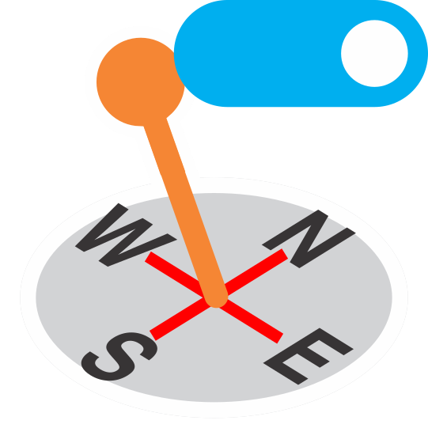
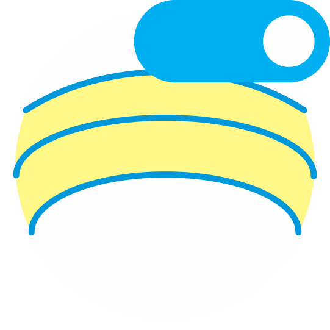

# igz_sunpath — Barra "Sun Path" para o IngeTrazo

[English](README.md) · **Português (Brasil)**

Uma barra de ferramentas para o [IngeTrazo](https://github.com/ingelibre/ingetrazo)
que fornece um ambiente completo de **análise solar**: alternância de
sombras, sliders de data e hora, calendário, um **vetor solar** 3D com
bússola em tela, um **domo solar** dinâmico (domus solar) com arcos de
trajetória do sol e analemas, controles de localização do projeto
integrados ao painel **Terreno** (Base Map) do IngeTrazo, e uma
**exportação PNG** da visão atual.

- **Autor:** Ezequiel M. Rezende
- **Repositório:** <https://github.com/em-rezende/Ingetrazo-igz-sunpath>
- **Data:** 2026-10-18
- **Versão:** 1.0.0
- **Testado com:** IngeTrazo 0.5.8 (Windows)
- **Licença:** [GPL-3.0-or-later](https://www.gnu.org/licenses/gpl-3.0.html)
  (a mesma do IngeTrazo — veja [LICENSE](LICENSE))

---


*A barra **Sun Path** na área superior — o toggle de sombras, o toggle
da seta do sol, o toggle do vetor solar, o toggle do domo, a
**Ferramenta Ajustar Sol**, o pick **Definir Centro**, o **Calendário**,
o seletor de mapa **Definir Localização** e o botão **Salvar PNG**. Na
tela: o **domo solar** 3D (arcos de trajetória, arco vermelho do dia
atual, analemas, bússola), o **vetor solar** (laranja) com sua projeção
(traço tracejado cinza) e os rótulos **Az / El** próximos à origem, o
diálogo **Ajustar Sol** à esquerda, o diálogo **Calendário** abaixo e a
**bússola em tela** à direita com seus sliders de **Data** / **Hora**.*

---

## Visão geral das ferramentas

| Ferramenta | Botão da barra | Ícone | Descrição |
| --- | --- | --- | --- |
| **Sombras on/off** | Sombras on/off |  | Liga ou desliga as sombras nativas do IngeTrazo. Funciona exatamente como o toggle de sombras do próprio host, mas a partir da barra Sun Path. |
| **Seta do Sol** | Seta do Sol |  | Mostra/oculta a **bússola em tela** (canto superior direito): rosa dos ventos com N/L/S/O, ponto amarelo na posição do sol, painel de informação (data, hora, lat, lon, azimute, elevação) e os dois sliders de **Data** / **Hora**. Todo o overlay é arrastável. |
| **Vetor Solar** | Vetor Solar |  | Mostra/oculta o **vetor solar 3D**: um raio laranja da origem do domo até a posição atual do sol, com uma bola na ponta, uma projeção tracejada cinza até o plano XY e um pequeno ponto na origem. Também desenha os rótulos `Az` / `El` próximo à origem e a hora `HH:MM` próximo à bola. É **rotacionado automaticamente** pela `Rotação do norte`. |
| **Domo Solar** | Domo Solar |  | Mostra/oculta o **domo solar** (domus solar): arcos mensais de trajetória, o **arco do dia atual em vermelho**, marcas horárias, rótulos de nascer/pôr do sol, analemas e a bússola de solo. As células entre meridianos são **clicáveis** — clicar define data e hora simultaneamente e liga o **Vetor Solar** (desliga a **Seta do Sol**). Use **TAB** para alternar o filtro de semestre (Jan–Jun / Jul–Dez). |
| **Ferramenta Ajustar Sol** | Set Sun Tool |  | Abre o diálogo **Ajustar Sol**: sliders de data/hora, leitura de azimute/elevação, rotação do norte, caixa de localização (fonte / coords / Definir Localização 🗺️ / Carregar mapa) e controles do domo (tamanho do diagrama, Definir Centro, toggles de analemas/horas/datas/bússola) além dos quatro botões de alternância (Sombras on/off, Seta do Sol, Vetor Solar, Domo Solar). |
| **Definir Centro** | Definir Centro |  | Entra no **modo de picking** para escolher a origem 3D do domo clicando em qualquer lugar na viewport. O pick usa o **motor OSNAP** do host (vértices, arestas, faces) — a flag `uses_snap` da ferramenta ativa é **temporariamente forçada para `True`** para que o `SelectTool` resolva o snap; ela é restaurada ao fim do picking. Uma bola colorida de preview mostra o tipo de snap: amarelo (vértice), ciano (aresta), verde (face), cinza (plano). Cancele com **ESC** ou **clique direito**. |
| **Calendário** | Calendário |  | Abre um **diálogo compacto de calendário** com seletor de data e editor de hora `HH:mm`. Ambos os valores são aplicados a `scene.shadows` imediatamente ao clicar em **OK**. |
| **Definir Localização** | Definir Localização |  *(fallback 🗺️)* | Abre o seletor de mapa nativo do **Terreno** no IngeTrazo; aplica a latitude/longitude escolhidas a `scene.georef` e atualiza o cálculo solar. Opcionalmente mantém os tiles do mapa baixados (via checkbox **Carregar mapa** no diálogo). |
| **Salvar PNG** | Salvar PNG |  | Abre um **mini-diálogo com as opções de exportação** (fundo transparente, sim/não) e, em seguida, um `QFileDialog`. Salva a viewport atual em **PNG**: no modo **branco**, o modelo 3D + overlay solar sobre fundo branco; no modo **transparente**, **apenas o overlay solar** sobre fundo transparente. O nome sugerido é `sunpath_YYYYMMDD_HHmmss.png` na pasta **Imagens** do usuário; uma confirmação aparece tanto na barra de status quanto em uma caixa de mensagem. Funciona mesmo com a janela do IngeTrazo minimizada. |

---

## Arquivos

```
<plugins>/
└── igz_sunpath/
    ├── __init__.py              # ponto de entrada do pacote (setup(app))
    ├── igz_sunpath.py           # barra "Sun Path" (módulo principal)
    ├── README.md                # versão em inglês
    ├── README_ptBR.md           # este arquivo (versão em português)
    ├── CHANGELOG.md             # histórico de versões
    ├── PUBLISHING.md            # guia de release e submissão ao catálogo
    ├── LICENSE                  # texto completo da GPL-3.0
    ├── THIRD-PARTY.md           # avisos de terceiros
    ├── icons/
    │   ├── sunpath_arrow.svg    / sunpath_arrow_light.svg
    │   ├── sunpath_calendar.svg / sunpath_calendar_light.svg
    │   ├── sunpath_center.svg   / sunpath_center_light.svg
    │   ├── sunpath_dome.svg     / sunpath_dome_light.svg
    │   ├── sunpath_map.svg      / sunpath_map_light.svg
    │   ├── sunpath_screenshot.svg  / sunpath_screenshot_light.svg
    │   ├── sunpath_shadows.svg  / sunpath_shadows_light.svg
    │   ├── sunpath_tool.svg     / sunpath_tool_light.svg
    │   └── sunpath_vector.svg   / sunpath_vector_light.svg
    ├── i18n/
    │   ├── en.json
    │   ├── pt-BR.json
    │   ├── de.json
    │   ├── es.json
    │   ├── fr.json
    │   ├── it.json
    │   └── zh-CN.json
    └── screenshots/
        └── igz_sunpath.png
```

O repositório também traz as ferramentas de publicação (não são
necessárias em tempo de execução):

```
packaging/   build_extension.py / .ps1, igz_sunpath.toml
tests/       testes estáticos + teste de fumaça opcional com PySide6
.github/     CI do GitHub Actions
```

---

## Bússola em tela (overlay)

Quando **Seta do Sol** está ligada, um pequeno overlay aparece no canto
superior direito da viewport. É um **QWidget filho** da viewport, então
flutua sobre o conteúdo 3D sem interferir com a câmera, seleção ou zoom.

### Rosa dos ventos

- **Círculo** com rótulos cardeais **N / L / S / O**.
- **Ponto amarelo + linha** mostrando o azimute atual do sol, atualizado
  ao vivo com data e hora.

### Painel de informação

Abaixo da rosa dos ventos, um painel escuro semi-transparente mostra três
linhas:

```
Data: 05/02   Hora: 09:30
Lat: -19,9167   Lon: -43,9345
Azimute: 85,2º   Elevação: 36,3º
```

Todos os valores são atualizados em tempo real conforme os sliders ou o
diálogo mudam.

### Sliders de Data e Hora

Abaixo do texto informativo, **dois sliders finos** permitem varrer data
e hora sem abrir o diálogo:

- **Data** — slider horizontal cobrindo o ano inteiro (dia 1 → 365).
  Movê-lo **reposiciona o arco vermelho** (dia atual) sobre o domo solar
  e re-renderiza o vetor solar.
- **Hora** — slider horizontal cobrindo 00:00 → 23:59. Movê-lo desliza
  a bola do sol ao longo do arco vermelho.

Ambos os sliders são **sincronizados com o diálogo Ajustar Sol** e com o
domo solar: mover qualquer um deles (diálogo ou overlay) atualiza os
demais.

Todo o overlay é **arrastável** — clique em qualquer ponto da área da
rosa e arraste para reposicioná-lo. Os sliders e o painel de informação
acompanham.

---

## Diálogo "Ajustar Sol"

O diálogo reúne em uma só janela tudo o que é relacionado ao sol e ao
local.

### Data e hora

| Controle | Campo afetado | Faixa |
|---------|---------------|-------|
| Slider **Data** | `scene.shadows.month` + `.day` | 1–365 (dia do ano) |
| Slider **Hora** | `scene.shadows.hour` + `.minute` | 0–1439 min |

### Painel de informação

- **Azimute** e **Elevação** do sol, em graus, atualizados ao vivo com a
  data e a hora.

### Rotação do norte

- Spinbox **Rotação do norte** (`0–360°`) — escreve em
  **`scene.georef.north`**, o mesmo campo que o painel **Terreno** do
  IngeTrazo usa. Alterá-lo rotaciona o domo, o vetor solar, a bússola
  **e** as sombras nativas do modelo do IngeTrazo no quadro seguinte.

### Caixa de localização

| Controle | Campo afetado | Faixa |
|---------|---------------|-------|
| Combo **Fonte** | Fonte de mapa do painel Terreno | Esri Imagery / Sentinel-2 cloudless / OpenStreetMap |
| Campo **Coordenadas** | `scene.georef.lat` + `.lon` | texto editável (`lat, lon`) |
| **Definir Localização** (ícone 🗺️) | Abre o seletor de mapa nativo do IngeTrazo | — |
| Checkbox **Carregar mapa** | Se os tiles baixados são mantidos | on/off |

### Caixa do Domo Solar

*Visível somente quando **Domo Solar** está ligado.*

| Controle | Campo afetado | Faixa |
|---------|---------------|-------|
| Slider **Tamanho do diagrama** | Escala do domo no mundo | 20–2000% |
| Botão **Definir centro** | Origem do domo (`_DOME_CENTER_XYZ`) | pick via OSNAP |
| Rótulo **Centro** | Origem atual do domo (x, y, z) | somente leitura |
| Checkbox **Analemas** | Mostrar/ocultar os analemas | on/off |
| Checkbox **Rótulos de hora** | Mostrar/ocultar as horas no arco vermelho | on/off |
| Checkbox **Rótulos de data** | Mostrar/ocultar as datas em nascer/pôr do sol | on/off |
| Checkbox **Bússola N** | Mostrar/ocultar os círculos de solo e a seta **N** | on/off |

### Botões inferiores

| Botão | O que faz |
|-------|-----------|
| **Sombras on/off** | Alterna as sombras nativas do host (mesmo que a ação da barra) |
| **Seta do Sol** | Mostra/oculta a bússola em tela |
| **Vetor Solar** | Mostra/oculta o vetor solar 3D |
| **Domo Solar** | Mostra/oculta o domo solar |
| **Fechar** | Fecha o diálogo (as alterações já estão persistidas) |

### Persistência

Toda alteração feita no diálogo é **persistida no documento**:

- Estados de alternância (`igz_dome_active`, `igz_sun_vector_active`,
  `igz_overlay_visible`), a escala do diagrama
  (`igz_dome_diagram_scale`), as quatro flags de exibição
  (`igz_dome_show_*`), a origem do domo (`igz_dome_center` como
  `[x, y, z]`) e a **preferência de exportação PNG**
  (`igz_export_transparent`) são armazenados **como atributos do
  objeto scene** (com o prefixo `igz_`).
- A **rotação do norte** é armazenada em **`scene.georef.north`** — o
  mesmo campo usado pelo painel **Terreno** do IngeTrazo, portanto é
  totalmente interoperável com o host.
- A **data e a hora** são armazenadas em **`scene.shadows`** — o mesmo
  dataclass usado pela barra de sombras do IngeTrazo.

Reabrir um `.igz` salvo restaura exatamente a mesma configuração,
**inclusive a preferência de fundo transparente**.

---

## Domo solar (domus solar)

O domo é desenhado em **3D verdadeiro** sobre a viewport, projetado com
a API `viewport.world_to_pixel(QVector3D)` do próprio IngeTrazo — a mesma
chamada que o host usa em seus próprios overlays. Isso significa que o
domo rotaciona corretamente com a câmera, é recortado nas bordas do
widget e acompanha naturalmente qualquer órbita / pan / zoom.

### Elementos

- **Arcos de trajetória** — 12 arcos, um para o dia 15 de cada mês,
  mais um arco destacado para o **dia atual** (veja abaixo):
  - **Contínuo** para os meses **1–6** (verão e outono do hemisfério
    sul, até o solstício de junho).
  - **Tracejado** para os meses **7–12** (inverno e primavera do
    hemisfério sul).
  - **Todos em azul** (`40, 90, 220`).
- **Arco do dia atual (vermelho)** — um arco extra desenhado em
  **vermelho**, na data exata selecionada no diálogo Ajustar Sol. Esse
  arco carrega os **rótulos de hora** (5…19) em cinza escuro ao lado de
  cada marca horária. Mover o slider de Data (diálogo ou overlay)
  **reposiciona este arco** sobre o domo.
- **Marcas horárias** — pequenos pontos azuis (raio 1,5 px) em cada hora
  cheia (5h–19h) de cada arco.
- **Rótulos de data** — mês/dia (por exemplo `15/3`) nos pontos de
  **nascer** e **pôr do sol** de cada arco, em preto.
- **Analemas** — 13 curvas, uma para cada hora cheia (6h–18h), cada uma
  traçada ao longo de um ano inteiro em passos de 5 dias (73 amostras +
  ponto de fechamento), desenhadas em cinza médio. Produzem as
  características formas de "oito". Podem ser desligados pelo checkbox
  **Analemas**.
- **Bússola de solo** — dois círculos concêntricos (R e 0,9 R) em verde
  claro, com **marcas radiais a cada 10°** e uma seta lilás apontando
  para o **Norte** atual, rotulada com um **N** roxo.
- **Células clicáveis** — quadriláteros entre meridianos mensais
  consecutivos (dia 15) e horas cheias consecutivas. Passar o mouse
  destaca a célula em amarelo com seus quatro rótulos `d/m: hh-0`;
  clicar define data e hora simultaneamente e liga o **Vetor Solar**.
- **Filtro de semestre** — a tecla **TAB** alterna o conjunto de meses
  cujas células estão ativas: **Jan–Jun** (padrão) ou **Jul–Dez**. O
  filtro ativo é exibido como `Período: Jan-Jun (TAB)` /
  `Período: Jul-Dez (TAB)` no canto inferior esquerdo da viewport.

### Matemática solar

O plugin calcula a posição do sol a partir de **latitude**,
**longitude** e **data/hora** usando:

- **Declinação solar** — aproximação astronômica padrão
  (`23,45° · sin(360° · (284 + doy) / 365)`).
- **Equação do tempo** — aproximação de Spencer (1971)
  (`9,87·sin(2B) − 7,53·cos(B) − 1,5·sin(B)`, B = 360·(doy − 81)/364),
  resultando em ±15 min de correção em relação ao tempo solar aparente.
- **Ângulo horário solar local** a partir do tempo solar verdadeiro.
- **Azimute e elevação** pelas fórmulas padrão de trigonometria
  esférica. No zênite exato o azimute é indefinido e o código o fixa em
  0° para evitar ruído numérico.

O resultado concorda com referências de terceiros (por exemplo o
[Sun-Path 2D](https://andrewmarsh.com/apps/releases/sunpath2d.html) de
Andrew Marsh) dentro de ±0,5° em datas e latitudes típicas.

### Rotação do norte

`Rotação do norte` (no diálogo Ajustar Sol) escreve em
**`scene.georef.north`** — o mesmo campo que o painel **Terreno** do
IngeTrazo expõe como *Norte*. Assim que o campo muda,
**as sombras nativas do modelo do IngeTrazo também rotacionam**, porque
o host relê esse campo a cada quadro.

Valores positivos rotacionam o Norte em **sentido horário** (acompanhando
o painel Terreno), o que faz toda a cena — domo, vetor solar, bússola,
sombras e os **rótulos Az / El próximo à origem** — seguir a nova
orientação. A leitura numérica do **Azimute** no painel de informação
permanece **geográfica** (ou seja, o ângulo real do sol a partir do
Norte verdadeiro), independente da rotação da tela.

### Tamanho do diagrama

O slider `Tamanho do diagrama` escala o domo de **20% a 2000%**
(0,20 → 20,0). A escala se aplica ao diagrama inteiro (raio, bússola,
vetor solar, analemas). O cache do domo é invalidado sempre que a escala
muda, portanto não é necessário reiniciar.

O **raio base** (`_DOME_BASE_RADIUS`, padrão 5,0 m no código),
multiplicado pela escala, fornece o raio efetivo em metros. A 100% o
domo tem 10 m de diâmetro; a 500%, 50 m; a 2000%, 200 m.

### Origem do domo (Definir Centro)

A origem do domo pode ser posicionada em qualquer ponto do modelo usando
**Definir Centro** (botão da barra ou o botão **Definir Centro** dentro
da caixa *Domo Solar* do diálogo). O pick usa o **motor OSNAP** do host:

1. **`last_snap`** (se válido — tipo ≠ `none`) — o ponto exato que o
   OSNAP do IngeTrazo está mostrando sob o cursor.
2. **`pick_vertex` / `pick_edge` / `pick_face`** — os auxiliares de
   picking do próprio host, tentados nessa ordem de prioridade.
3. **`_snap_at`** — o próprio motor de snap (só aceito quando
   `kind ≠ 'none'`).
4. **`_snap_to_scene_vertex`** — fallback manual que percorre
   `scene.mesh` / `scene.faces` e retorna o vértice mais próximo dentro
   de uma tolerância de 12 px.
5. **`_world_under_cursor` / `_world_from_pixel`** — o plano de trabalho
   raso, como último recurso.

Como o `SelectTool` tem `uses_snap=False`, o plugin **temporariamente
faz um patch** para `uses_snap=True` na ferramenta ativa durante o
picking e restaura o valor original quando o pick termina (ou é
cancelado com **ESC** / clique direito). É isso que faz o marcador
visual nativo do OSNAP aparecer durante o picking.

O ponto escolhido é armazenado como `igz_dome_center` nos atributos da
cena (array `[x, y, z]`) e refletido no rótulo `Centro:`.

---

## Exportar PNG

O botão **Salvar PNG** abre um pequeno **mini-diálogo com as opções de
exportação**, seguido de um `QFileDialog`, e então salva a viewport atual
em **PNG**.

### Mini-diálogo de opções de exportação

Ao clicar em **Salvar PNG** na barra, abre-se primeiro um diálogo
compacto:

- Checkbox **Fundo transparente** (padrão: o valor que a cena guardou
  da última vez, ou seja, `igz_export_transparent`).
- Uma linha de dica: *"A imagem incluirá a viewport e o overlay solar."*
- Botões **Continuar** / **Cancelar**.

A preferência escolhida aqui é **persistida na cena**
(`igz_export_transparent`), portanto sobrevive a salvar / reabrir o
arquivo `.igz` — e, da próxima vez que você exportar, o checkbox já
começa no estado em que você deixou.

> **Nota:** a opção *Fundo transparente* **não** está no diálogo
> *Ajustar Sol* — ela fica neste mini-diálogo, direto no fluxo de
> exportação, que é o lugar natural para ela.

### O que entra na imagem

**Modo fundo branco** (checkbox **desmarcado**):

- A **viewport 3D** (modelo, terreno, sombras, câmera).
- O **overlay em tela** — rosa dos ventos, vetor solar, domo, analemas,
  rótulos Az/El, indicador de período, bola de preview do snap (se em
  picking).
- Um fundo **branco**.

**Modo fundo transparente** (checkbox **marcado**):

- **Somente o overlay em tela** — rosa dos ventos, vetor solar, domo,
  analemas, rótulos Az/El, indicador de período, bola de preview do snap
  (se em picking).
- Um fundo **transparente** — o modelo 3D e o terreno são
  **deliberadamente omitidos**, para que o overlay possa ser embutido em
  slides, pôsteres ou documentos de tema escuro sem uma caixa branca.

O diálogo **nunca** é capturado — a imagem contém apenas a viewport (ou
apenas o overlay) e os gráficos solares.

### Como exportar

1. Ajuste a cena — ângulo de câmera, data, hora, toggles do domo,
   rotação do norte etc.
2. Clique em **Salvar PNG** na barra.
3. No mini-diálogo, **marque** ou **desmarque** *Fundo transparente*, e
   clique em **Continuar**.
4. O `QFileDialog` abre com o nome sugerido
   `sunpath_YYYYMMDD_HHmmss.png`, na pasta **Imagens** (ou na pasta do
   plugin, como fallback).
5. Escolha um local e clique em **Salvar**.
6. A imagem é renderizada offscreen (viewport + overlay, ou apenas o
   overlay) e salva.
7. Uma **caixa de mensagem** de confirmação aparece com o caminho
   exato, e a barra de status mostra a mesma mensagem por 6 segundos.
8. Se a gravação falhar (permissão negada, arquivo bloqueado, etc.),
   uma caixa de mensagem com o motivo aparece — e, como rede de
   segurança, o plugin tenta a pasta temporária do sistema e avisa se o
   fallback funcionou.

### Detalhes de comportamento

| Aspecto | Comportamento |
|---------|---------------|
| **Tamanho** | Exatamente a largura × altura atuais da viewport em pixels (sem escala, sem upsampling). |
| **Formato** | PNG (lossless, suporta transparência). |
| **Fundo branco** | Preenche um `QPixmap` com `Qt.white`, renderiza a viewport, depois desenha o overlay. |
| **Fundo transparente** | Cria um `QImage` preenchido com `Qt.transparent`, renderiza **apenas o overlay** nele (a viewport 3D não é pintada). |
| **Múltiplos monitores** | Irrelevante — a imagem é renderizada em um `QPixmap` / `QImage` offscreen, não capturada da tela. |
| **Janela minimizada** | Funciona — `QWidget.render(...)` desenha independentemente da visibilidade da janela. |
| **Modo de picking ativo** | A bola de preview do snap atual entra na imagem. |
| **Sobrescrever** | O `QFileDialog` pede confirmação antes de sobrescrever um arquivo existente. |
| **Extensão do arquivo** | Se o usuário digitar um nome sem extensão, `.png` é adicionado automaticamente. |
| **Normalização do caminho** | `os.path.normpath()` é aplicado antes de salvar, então `D:/foo/bar.png` vira `D:\foo\bar.png` no Windows. |
| **Fallback** | Se o caminho escolhido falhar, o plugin tenta `<temp>/igz_sunpath/<nome>.png` e informa o resultado via caixa de confirmação. |
| **Log** | Com `DEBUG = True`, o console imprime `capture: saved <caminho> (LxA) transparent=<bool>`. |
| **Caminhos com acentos** | Totalmente suportado (Qt usa UTF-16 internamente). |
| **Ícones na imagem** | Os ícones da barra e do diálogo **não** fazem parte da imagem. |

### Dicas para alta qualidade

- **Screenshot em Full HD** — redimensione a janela do IngeTrazo para
  pelo menos 1920×1080 antes de clicar em **Salvar PNG**. A imagem sai
  pixel-a-pixel igual à viewport.
- **Relatórios em papel branco** — deixe **Fundo transparente**
  desmarcado. A imagem sai com o modelo 3D + overlay sobre branco.
- **Inserir em slides com tema escuro** — marque **Fundo transparente**.
  Só o domo e os rótulos aparecem na imagem; as faces 3D do modelo não.
  Se você precisar do modelo 3D com fundo transparente, isso não é
  suportado pela viewport atual (o host pinta seu próprio fundo opaco
  antes da extensão conseguir desenhar).
- **Documentar a origem escolhida** — deixe o modo **Definir Centro**
  ativo (com a bola colorida visível) ao clicar em **Salvar PNG**; a
  bola fará parte da imagem.

---

## Ícones e temas

Cada botão traz **duas variantes de ícone**, para manter a barra legível
em interfaces escuras e claras:

- `sunpath_<nome>.svg` — a variante padrão (usada em temas escuros).
- `sunpath_<nome>_light.svg` — a variante para tema claro.

No start-up, `_load_themed_icon()` inspeciona a cor `QPalette.Window` da
janela principal. Em uma UI **clara** ele carrega o arquivo `_light.svg`
quando existe e, senão, cai de volta para o ícone padrão; em uma UI
escura ele sempre usa o padrão. Nenhuma configuração é necessária — os
ícones acompanham o tema da aplicação automaticamente.

O botão **Definir Localização** usa o emoji `🗺️` como fallback, para
funcionar mesmo sem nenhum arquivo de ícone. O botão **Salvar PNG** usa
`sunpath_screenshot.svg` (ou a variante `_light`).

---

## Internacionalização

O plugin traz seus próprios **catálogos JSON** em `i18n/`, um por idioma
suportado:

| Arquivo | Idioma |
|---------|--------|
| `en.json`    | English (US) |
| `pt-BR.json` | Português (Brasil) |
| `de.json`    | Deutsch |
| `es.json`    | Español |
| `fr.json`    | Français |
| `it.json`    | Italiano |
| `zh-CN.json` | 简体中文 |

O catálogo é carregado em tempo de execução com base no idioma atual do
IngeTrazo (`core.i18n.current_language()`); chaves ausentes caem de
volta para `en.json`. Um timer de 1 segundo observa mudanças de idioma e
re-rotula a barra, o diálogo Ajustar Sol e os rótulos Az/El do overlay
instantaneamente.

Para adicionar um novo idioma, coloque um arquivo `<code>.json` em
`i18n/` com as mesmas chaves de `en.json`.

A exportação PNG usa as seguintes chaves (todas presentes no `en.json` e
nos 6 outros catálogos):

- `"Save PNG"` — título do mini-diálogo.
- `"Export options"` — cabeçalho da seção.
- `"Transparent background"` — rótulo do checkbox.
- `"If checked, the exported PNG will have a transparent background."` —
  tooltip do checkbox.
- `"The image will include the viewport and the solar overlay."` —
  linha de dica.
- `"Continue"` — botão aceitar.
- `"Cancel"` — botão cancelar.
- `"Could not save the image to:\n{path}\n\nDetails:\n{details}"` —
  mensagem de falha com os detalhes de diagnóstico.
- `"Image saved: {path}"` — mensagem de sucesso.
- `"Image saved (fallback): {path}"` — mensagem de sucesso quando o
  caminho de fallback (a pasta temporária do sistema) foi usado.

---

## Compatibilidade com a API de plugins do IngeTrazo

O IngeTrazo declara em
[`docs/plugins.md`](https://github.com/ingelibre/ingetrazo/blob/main/docs/plugins.md):

> A API de plugins **ainda não é estável** — espere mudanças quebrantes
> durante a série 0.x.

O plugin **funciona** no IngeTrazo 0.5.8 mas usa alguns pontos que
**não fazem parte da API pública de extensões**. Lista consolidada:

| Símbolo | Onde | Por quê |
|---|---|---|
| `viewport.scene.shadows` | `_get_shadows` | Cadeia interna; a cena não está em `app.scene` |
| `ShadowSettings.{enabled, month, day, hour, minute, darkness}` | vários | Dataclass interno (`core.sun`) |
| `scene.georef.{lat, lon, north}` | `_read_georef_from_scene` / `_read_north_rotation` | Dataclass interno (`SceneDatum`) |
| `viewport.world_to_pixel(QVector3D)` | todo desenho do painter | API pública para extensões, mas não está no `plugins.md` |
| `viewport.{_snap_at, last_snap, pick_vertex, pick_edge, pick_face, _world_under_cursor, _world_from_pixel}` | `_pick_with_osnap` | Motor de snap interno; usado por **Definir Centro** |
| `viewport.active_tool.uses_snap` | `_patch_uses_snap_for_picking` | Flag interna; temporariamente posta em `True` durante **Definir Centro** |
| Internos de `BaseMapPanel` (`_source`, `_find`, `_lat`, `_lon`, `_last_sid`) | `_open_native_georef_dialog` | Alcançados via `findChildren`; o painel **Terreno** não é API pública |
| Snapshot de `scene.{tile_layer, terrain, photo_mesh}` | `_open_native_georef_dialog` | Atributos internos da cena, restaurados quando *Carregar mapa* está desligado |
| `QToolBar` + `MainWindow.addToolBar(...)` | `_create_sunpath_toolbar` | Barras horizontais não têm API oficial na série 0.x |
| Overlay em widget (`_SunArrowOverlay` como filho da viewport) | `_ensure_overlay` | Não coberto pelo `plugins.md`; conta com a viewport sendo um `QWidget` comum |
| `QWidget.render(QPainter, QPoint)` / `QWidget.render(QPaintDevice)` | `_capture_viewport_to_png` | API pública do Qt, mas depende da viewport ser um `QWidget` comum. **No PySide6 ≥ 6.4, o overload `render(QPainter)` exige `targetOffset`** (`QPoint(0, 0)`) |

### O que **está** em conformidade com o `plugins.md`

- Arquivo `.py` na pasta correta de plugins.
- Define `setup(app)` no escopo do módulo.
- Tolerante a falhas: qualquer exceção dentro dos callbacks é capturada
  e registrada — o app continua funcionando.
- Não modifica o documento sem passar pelas estruturas de dados
  próprias da cena.
- Não assume `sys.path` e não importa seu próprio pacote.
- Respeita threading (tudo na thread principal).
- Usa **APIs públicas do Qt** (`QFileDialog`, `QPixmap`, `QImage`,
  `QStandardPaths`, `QDateTime`) para a exportação PNG — nada interno.

### O que **não** é coberto pelo `plugins.md`

- Barras horizontais **não têm API oficial** na versão 0.x. O documento
  menciona `app.add_panel(...)` (aba lateral),
  `app.add_menu_action(...)` (entrada de menu) e `app.add_context_menu(...)`,
  mas não `add_toolbar(...)`. Esta extensão usa `QToolBar` **diretamente
  via PySide** — funciona, mas é o caminho "informal".
- Não há subclasse de `tools.base.Tool`. Isso significa que o plugin
  **não aparece no menu Extensões**, não tem atalho e não aparece na
  busca F3. Se isso for desejado, veja "Melhorias futuras" abaixo.
- Nenhuma persistência via `app.document_data`. O estado próprio do
  plugin é armazenado diretamente no objeto scene (veja a seção
  **Persistência**), o que sobrevive à sessão atual mas não é parte de
  uma API formal.

### Se a API 0.x quebrar

- **Georef / Norte:** `scene.georef.lat`, `.lon`, `.north` → verifique
  se `app.scene` passa a expor a cena diretamente.
- **Projeção:** `viewport.world_to_pixel` → migrar quando uma API
  formal aparecer.
- **Barra:** `QToolBar` → migrar para `app.add_toolbar(...)` quando
  aparecer.
- **Overlay:** a bússola em tela usa um `QWidget` filho da viewport; se
  o IngeTrazo mudar a classe da viewport para algo que não seja um
  `QWidget` puro, o overlay precisa ser re-parentado ou substituído por
  um hook de overlay nativo. **O mesmo vale para a exportação PNG**, que
  chama `viewport.render(pixmap)` — método de `QWidget`.
- **Definir Centro / OSNAP:** `_pick_with_osnap` depende de
  `viewport.{_snap_at, last_snap, pick_vertex, pick_edge, pick_face}` e
  da flag `uses_snap`. Se algum desses desaparecer, o pick cai para
  `_snap_to_scene_vertex` e, em seguida, para o plano de trabalho.

---

## Instalação

### Manual (IngeTrazo 0.5.8)

1. Baixe `igz_sunpath.zip` da
   [última release](https://github.com/em-rezende/Ingetrazo-igz-sunpath/releases/latest)
   e descompacte.
2. Localize a pasta de plugins do IngeTrazo:
   - **Linux:** `~/.local/share/ingetrazo/plugins/`
   - **Windows:** `%APPDATA%\ingetrazo\plugins\`
   - Ou use o menu **Extensões ▸ Abrir pasta de plugins**.
3. Mova a pasta **`igz_sunpath`** descompactada para essa pasta de
   plugins, para que os arquivos fiquem em `<plugins>/igz_sunpath/` (ela
   contém `__init__.py`, o módulo principal, a documentação e as pastas
   `icons/` e `i18n/`).
4. Reinicie o IngeTrazo.

A barra **Sun Path** aparece na área superior, junto às outras barras.

### Pelo catálogo de extensões do IngeTrazo

Depois que a ficha estiver no catálogo da comunidade em
<https://ingetrazo.com/extensiones>, a extensão pode ser instalada por
**Extensões ▸ Gerenciar extensões…** (o gerenciador do 0.5.8 instala a
partir desse catálogo; ele não tem seletor de arquivo local). A ficha
pronta para envio está em
[`packaging/igz_sunpath.toml`](packaging/igz_sunpath.toml), e o
[`PUBLISHING.md`](PUBLISHING.md) descreve a release e a submissão.

---

## Desenvolvimento

```powershell
# Verificações estáticas (sem Qt): sintaxe, i18n, ícones, links,
# catálogo, layout e hash determinístico do ZIP.
python -m unittest discover -s tests -v

# Teste de fumaça opcional da GUI, se PySide6 puder ser importado.
python -m unittest tests.test_gui_smoke -v

# Gera dist/igz_sunpath.zip e atualiza packaging/igz_sunpath.toml.
python packaging/build_extension.py --write-catalog
python packaging/build_extension.py --check
```

O plugin tem um único módulo, `igz_sunpath.py`, dividido em seções
numeradas; `__init__.py` apenas expõe `setup(app)`. `DEBUG = False` nas
releases — mude para `True` localmente para registrar logs em stderr.

---

## Uso

### Sombras on/off
- Clique em **Sombras on/off** para alternar as sombras nativas do
  IngeTrazo. O botão da barra e o botão do diálogo permanecem
  sincronizados — ambos leem `scene.shadows.enabled`.

### Seta do Sol + bússola em tela
- Clique em **Seta do Sol** para mostrar a bússola em tela — um pequeno
  círculo no canto superior direito da viewport com rótulos N/L/S/O e um
  ponto amarelo mostrando onde o sol está agora.
- O painel abaixo da bússola mostra data, hora, latitude, longitude,
  azimute e elevação.
- Dois sliders abaixo do painel permitem varrer **Data** e **Hora**
  diretamente na viewport, sem abrir o diálogo.
- Arraste a bússola (em qualquer ponto da rosa) para reposicioná-la.

### Vetor Solar
- Clique em **Vetor Solar** para mostrar o raio solar 3D: uma linha
  laranja da origem do domo até a posição atual do sol, com uma bola na
  ponta e um pequeno ponto na origem. Uma linha tracejada cinza curta
  desce do sol até o plano XY e, de lá, até a origem, mostrando a
  projeção do sol no solo.
- A hora atual é exibida ao lado da bola laranja.
- Os rótulos `Az:` e `El:` são desenhados próximo à origem, em duas
  linhas empilhadas, na mesma cor do vetor solar. Ambos os valores são
  **geográficos** (independentes da `Rotação do norte`).
- Tanto a ponta quanto os rótulos **rotacionam juntos** com a
  `Rotação do norte`, então o vetor está sempre alinhado ao arco
  vermelho do domo.

### Domo Solar
- Clique em **Domo Solar** para mostrar o domo inteiro: arcos de
  trajetória, analemas, marcas horárias, rótulos de nascer/pôr do sol e
  a bússola de solo.
- Um **arco vermelho** destaca o **dia atual** e carrega os rótulos de
  hora (5…19).
- **Passe o mouse sobre uma célula** entre meridianos e horas — ela é
  destacada em amarelo com quatro rótulos `d/m: hh-0` nos cantos.
- **Clique em uma célula** para definir data e hora simultaneamente. O
  plugin desliga a **Seta do Sol** (se estiver ligada) e liga o
  **Vetor Solar** (se estiver desligado), para você ver imediatamente a
  posição escolhida do sol.
- Pressione **TAB** para alternar o filtro de semestre
  (Jan–Jun ↔ Jul–Dez). O filtro ativo é exibido como
  `Período: Jan-Jun (TAB)` / `Período: Jul-Dez (TAB)`.
- Abra **Ferramenta Ajustar Sol** para controlar o domo: escala,
  rótulos de hora, rótulos de data, bússola, visibilidade dos analemas,
  rotação do norte e definir centro.
- Altere a **data** ou a **hora** — seja no diálogo ou nos sliders da
  bússola em tela — e todo o domo é atualizado instantaneamente,
  incluindo a posição do arco vermelho.
- Altere a **latitude/longitude** na caixa de localização (ou pelo
  botão **Definir Localização** da barra) e o domo se reorienta para o
  novo local imediatamente.

### Definir Centro
- Clique em **Definir Centro** (na barra ou no botão **Definir Centro**
  dentro da caixa *Domo Solar* do diálogo) para entrar no modo de
  picking.
- Mova o mouse sobre o modelo: o motor OSNAP do host acende (vértices,
  arestas, faces) e a bola de preview do overlay mostra o tipo de snap
  atual — **amarelo** (vértice), **ciano** (aresta), **verde** (face),
  **cinza** (plano).
- Clique para confirmar. O domo é re-centrado nesse ponto.
- Pressione **ESC** ou **clique direito** para cancelar sem alterar a
  origem.
- O ponto escolhido é armazenado como `igz_dome_center` e sobrevive a
  salvar / reabrir o arquivo `.igz`.

### Definir Localização
- Clique em **Definir Localização** (🗺️) para abrir o seletor de mapa
  nativo do **Terreno** no IngeTrazo. Escolha um lugar e a
  latitude/longitude são aplicadas à cena. O domo e o vetor solar
  recalculam automaticamente.
- O ícone 🗺️ fica ao lado do campo **Coordenadas** no diálogo Ajustar
  Sol. A mesma ação também está disponível na barra de ferramentas (o
  último botão antes de **Salvar PNG**).

### Calendário
- Clique em **Calendário** para abrir um pequeno diálogo de calendário
  com um editor de hora `HH:mm`. Ambos os valores são aplicados a
  `scene.shadows` ao clicar em **OK**, e os sliders da bússola em tela
  permanecem sincronizados.

### Salvar PNG
1. Ajuste a cena — ângulo de câmera, data, hora, toggles do domo,
   rotação do norte etc.
2. Clique em **Salvar PNG** na barra.
3. No mini-diálogo, marque/desmarque **Fundo transparente** e clique
   em **Continuar**.
4. O diálogo de arquivo abre com o nome sugerido
   `sunpath_YYYYMMDD_HHmmss.png`, em **Imagens** (ou na pasta do plugin
   como fallback).
5. Escolha um local e clique em **Salvar**.
6. A imagem é renderizada offscreen e salva. Uma **caixa de mensagem**
   aparece com o caminho exato; a barra de status mostra a mesma
   mensagem por 6 segundos.
7. Se a gravação falhar (ex.: permissão negada), o plugin tenta um
   fallback na pasta temporária do sistema e informa o resultado.
8. Se o modo **Definir Centro** estiver ativo, a bola colorida de
   preview entra na imagem — útil para documentar o ponto escolhido.

---

## Melhorias futuras (opcionais)

Tudo o que o `plugins.md` recomenda e que **não** está implementado
ainda. Nenhuma dessas melhorias é obrigatória — o plugin funciona bem
sem elas.

1. **Subclasse de `Tool`**: "Sun Path…" no menu Extensões, com atalho.
   Permite reabrir a barra caso ela seja fechada.

2. **Exportação PNG em alta resolução**: adicionar um seletor de
   "Resolução" nas opções de exportação (1×, 2×, 4×). O domo é vetorial,
   então um render 2× ou 4× mantém os rótulos e arcos nítidos na
   impressão. A implementação renderiza em um `QPixmap` de
   `w*escala × h*escala` após `painter.scale()`.

3. **Copiar imagem para a área de transferência**: uma segunda ação na
   barra "Copiar PNG" que envia o `QPixmap` renderizado para
   `QApplication.clipboard()`, permitindo colar direto em chat / e-mail
   sem salvar arquivo.

4. **Exportar como SVG**: renderizar o overlay em um `QSvgGenerator`
   em vez de `QPixmap`, gerando saída vetorial (o conteúdo 3D da
   viewport continuaria raster).

5. **Projeções adicionais**: oferecer um diagrama 2D **estereográfico**
   de trajetória (como a ferramenta de Andrew Marsh) como alternativa
   ao domo 3D, para usuários que preferem gráficos solares clássicos.

6. **Destaque multi-dia**: mostrar vários dias consecutivos como arcos
   vermelhos (por exemplo uma janela de ±3 dias), para análise de massa
   térmica.

7. **Controle de fuso horário**: expor `utc_offset` no diálogo Ajustar
   Sol (o campo existe em `ShadowSettings` mas hoje não é editável pelo
   usuário).

8. **Persistência formal**: mover os atributos `igz_*` da cena para
   `app.document_data` quando o host expuser, para que o estado fique
   em um local documentado em vez de atributos dinâmicos.

9. **Reanexação da barra**: quando o host recriar as barras, a barra
   Sun Path deve se reanexar automaticamente em vez de exigir reinício.

---

## Licença

GPL-3.0-or-later — a mesma licença do IngeTrazo.
Avisos de terceiros são registrados em [THIRD-PARTY.md](THIRD-PARTY.md).

Veja <https://www.gnu.org/licenses/gpl-3.0.html>.

Copyright (C) 2026 Ezequiel M. Rezende.

Este programa é software livre: você pode redistribuí-lo e/ou
modificá-lo sob os termos da GNU General Public License, versão 3 ou
posterior, conforme publicada pela Free Software Foundation.

Este programa é distribuído na esperança de ser útil, mas **sem
qualquer garantia**; sem sequer a garantia implícita de
**comercialização** ou **adequação a um propósito específico**. Veja a
GNU General Public License para mais detalhes.
